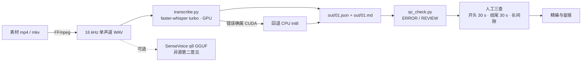

<h1 align="center">asr-transcription</h1>

<p align="center">
  <b>简体中文</b> | <a href="./README_EN.md">English</a>
  <br><br>
  <a href="LICENSE"></a>
  <a href="https://www.python.org/"></a>
  
  
</p>

给 Agent 加载的中文音视频转写技能包：选型、参数、质检脚本与第三方归属，附 1028 条离线断言。

> [!NOTE]
> 本仓库由 AI 辅助开发，脚本与数字都经人工实测复核，过程记录在 [`ROADMAP.md`](ROADMAP.md)。未验证的平台不写成「已支持」，见[已知限制](#已知限制)。



装好依赖后，一条音频三步走：

```powershell
python -m pip install "faster-whisper==1.2.1" "ctranslate2==4.8.1" "av<19"
python scripts/transcribe.py --wav "01.wav" --model "<模型目录>" --out "out/01.json" --tag "01"
python scripts/qc_check.py "out/01.json"
```

完整前置条件与自检步骤见[快速开始](#快速开始)。

## 目录

- [为什么做这个项目](#为什么做这个项目)
- [快速开始](#快速开始)
- [用法](#用法)
- [配置](#配置)
- [项目结构](#项目结构)
- [开发](#开发)
- [常见问题](#常见问题)
- [已知限制](#已知限制)
- [第三方项目与许可证](#第三方项目与许可证)
- [如何贡献](#如何贡献)
- [许可证](#许可证)

## 为什么做这个项目

起点是真实的转写任务，不是先有框架再找场景。要把一批中文口播视频转成逐字稿，换过几套方案之后，失败很少来自模型本身：

- 开头把提示语原文念进正文
- 结尾凭空生成「谢谢观看」这类片尾话术
- 中间整段消失，只看输出看不出来
- GPU 的 cuBLAS / cuDNN DLL 找不到，而文件其实就在磁盘上
- `--json` 重定向到文件，编码变成 GBK，不再是合法 JSON

这些问题换模型解决不了。它们属于流程：环境怎么锁、参数怎么填、结果怎么验、数字能不能外推。所以这个仓库的重心是流程，不是模型。

脚本负责能自动化的四件事：环境自检、单条转写、批量转写、结果质检。判断留给人和 Agent：开头结尾要回听，长间隙要对照，没有标准答案就不报准确率。

三条铁律写在 `SKILL.md` 里，也写在这里：

1. **转完必做三查**：开头 30 秒、结尾 30 秒、任意相邻两段间隔 > 8 秒。四个数字指标全过也不能免。
2. **没有可信标准答案就不报准确率**：人工稿或官方字幕才算字错率；画面字幕 OCR 只能当旁证；差异度不是准确率。
3. **同源两版不等于两双眼睛**：turbo 是 large-v3 的解码器剪枝版，共享编码器，错误高度相关。要独立第二意见，得换架构。

它不是什么：不训练模型、不发布权重、不做云端服务、不含任何音频素材。仓库里只有流程、脚本和归属登记。

## 快速开始

### 前置要求

| 项 | 要求 |
|---|---|
| 系统 | Windows 11（唯一实测平台，其他平台见[已知限制](#已验证的平台)） |
| Python | 3.13.x（2026-11-06 实测 3.13.14） |
| FFmpeg | `ffmpeg` 与 `ffprobe` 都在 `PATH` |
| GPU（可选） | NVIDIA，CUDA 12.x / cuDNN 9，显存 ≥ 8 GB；没有就加 `--device cpu` |
| 模型 | 一个 CTranslate2 目录，含 5 个文件：`config.json` / `model.bin` / `preprocessor_config.json` / `tokenizer.json` / `vocabulary.json` |
| 磁盘 | turbo 约 1.51 GiB、large-v3 约 2.88 GiB |

模型权重**不在本仓库**，需要自己下载（Hugging Face 或镜像）。没有模型时，`check_env.py` 与三套测试仍可运行。

### 安装

```powershell
git clone https://github.com/ChenChen913/asr-transcription-skill.git "$env:USERPROFILE\.workbuddy\skills\asr-transcription"
cd "$env:USERPROFILE\.workbuddy\skills\asr-transcription"
python -m pip install "faster-whisper==1.2.1" "ctranslate2==4.8.1" "av<19"
```

装完先自检。`check_env.py` 只读，不写文件；`run_smoke.py` 不需要模型、GPU 或网络：

```powershell
python scripts/check_env.py --models "<模型目录>"
python tests/run_smoke.py
```

### 跑通第一条

```powershell
# 1. 统一抽成 16 kHz 单声道 PCM WAV
ffmpeg -y -i "<素材>.mp4" -vn -ac 1 -ar 16000 -c:a pcm_s16le "01.wav"

# 2. 转写；GPU 失败且确属 CUDA 错误时自动回退 CPU
python scripts/transcribe.py --wav "01.wav" --model "<模型目录>" --out "out/01.json" --tag "01"

# 3. 质检
python scripts/qc_check.py "out/01.json"
```

跑完看三处：`out/01.json`（结构化）、`out/01.md`（带时间戳的可读稿）、JSON 里的 `device` 字段（`cuda` 还是 `cpu`）。**不要只看命令行的 `--device` 入参**，回退过的任务实际设备在输出里。

### 不想用 Skill 机制

四个脚本是普通 Python 3 程序。把仓库放在任意目录，直接 `python scripts/transcribe.py ...` 就能用，不需要 Agent 运行时。

想在其他 Agent 工具里按 Skill 加载，按各自文档规定的目录与元数据放置。**本仓库只实测过 WorkBuddy 用户级 Skill，不声称对其他工具已兼容。**

## 用法

### 自动化到哪一步

| 环节 | 归属 | 载体 |
|---|---|---|
| 环境自检 | 已自动化 | `scripts/check_env.py` |
| 单条转写 | 已自动化 | `scripts/transcribe.py` |
| 批量转写 | 已自动化 | `scripts/batch_transcribe.py` |
| 结果质检 | 已自动化 | `scripts/qc_check.py` |
| 回归测试 | 已自动化 | `tests/` 下三套 |
| 抽音频、异源对照、差异对齐、精编、留痕 | Agent 工作流 | Skill 指导 Agent 调命令、判读结果；没有对应脚本 |
| 首末段回听、建术语表、提供标准答案、商用许可核对 | 手动 | 需要人工判断 |

> 「文档写了完整流程」不等于「工具已经实现」。SenseVoice q8 GGUF 只有命令、没有封装脚本，是可选的独立对照方案。

### 单条转写

```powershell
python scripts/transcribe.py `
    --wav "01.wav" --model "<模型目录>" --out "out/01.json" --tag "01" `
    --device cuda --compute float16
```

回退有前提：只有错误信息命中 `cuda / cublas / cudnn / cudart / nvml / gpu / out of memory / no kernel image` 才换 CPU。模型文件损坏、音频解不出、参数不合法不回退——换 CPU 一样失败，回退只会把真正的错误埋掉。禁用回退用 `--no-fallback`。

| 退出码 | 含义 |
|---|---|
| `0` | 成功 |
| `2` | 输入或模型目录不可用 |
| `3` | 当前设备失败，且未回退 |
| `4` | GPU 与 CPU 都失败 |

### 批量转写

一个文件夹，或者多个：

```powershell
# 先看计划：不加载模型，不写文件
python scripts/batch_transcribe.py --input "<目录A>" "<目录B>" --out-dir "out" --dry-run

# 再开跑
python scripts/batch_transcribe.py --input "<目录A>" "<目录B>" --out-dir "out" --model "<模型目录>"
```

它只做四件事：

1. **串行**：一次一个模型实例。GPU 与 CPU 方案不并发，避免资源读数互相污染。
2. **跳过已完成**：判据是一组成套产物（JSON + MD），不是单个文件。
3. **失败隔离**：单文件非零退出或超时只记一笔，不影响其余。
4. **每文件独立产物**：与单跑同 schema，可直接喂给 `qc_check.py`。

产物布局：

```text
out/
├── <key>.json          每个输入一份，结构化
├── <key>.md            同名可读稿
├── <key>.json.prev     只有重跑中或重跑失败时才存在，不算完成
├── <key>.md.prev
└── _batch/summary.json 计数 + 每文件结果，每处理完一个就落盘
```

两个容易踩的点：

- **`json` 与 `md` 是一组**。跳过判据要求两份都完整，`--force` 也把两份一起改名成 `.prev`。写入端先改名 MD、后改名 JSON，所以「有 JSON ⇒ 有 MD」，被 kill 在半路的任务下一轮会补跑，不会被永久跳过。
- **只吃 PCM WAV**。`--pattern` 只筛文件名，不增加解码能力。匹配到非 `.wav` 时，开跑前打印 `[WARN]` 与一句 FFmpeg 转换命令，但不阻断——真正的解码错误由 `transcribe.py` 报。

退出码：`0` 全部成功｜`1` 有失败或超时｜`2` 用法或匹配错误。

### 质检

```powershell
python scripts/qc_check.py "out/*.json"
python scripts/qc_check.py "out/*.json" --json      # 严格 JSON，可进 CI
```

下面是一次实跑输出（合成样例，用于展示分级）：

```text
--- demo.json [REVIEW]
    (62.40s, 34 chars, 3 segs)
    punct/100=11.76  chars/min=32.7  segs/min=2.9  maxgap=10.50s  tail=38.40s  overrun=-38.40s
    [RED/REVIEW] LONG GAP 10.50s at 9.6-20.1s
    [warn] tail gap 38.40s > 10.0s (possible truncation)
    [warn] char density 32.7/min outside (200.0, 450.0)
```

| 标记 | 含义 | 动作 |
|---|---|---|
| `[ERROR]` / `"errors"` | 确定的输入数据问题：字段缺失、非数字、`NaN` / `Infinity`、负数、乱序、`duration` 无效 | 修输入或产出脚本，**不要当成「稿子转错了」** |
| ↳ 时间轴失效 | 负起点 / `end < start` / 乱序：数值能读，但时间轴不成立 | 三个时间指标置 `null`、`has_timestamps=false`、`note` 写 `INVALID TIMELINE`；`chars` 等文本指标照常 |
| `[RED/REVIEW]` / `"red"` | 风险信号：重叠、空文本、越界、长间隙、提示语回音、无时间戳 | 人工复核对应区间，**不等于判错** |
| `[warn]` | 粗筛指标越界：字符密度、段数、尾部空 | 参考，不单独触发退出码 |

阈值严格大于：`gap > 8.00 s`（8.00 不报，8.01 报）、`overrun > 0.50 s`。用 `--gap` / `--tail` 调整。有 ERROR 或 RED 时，文本与 `--json` 模式都返回退出码 1。

### 输出格式

`transcribe.py` 的 JSON 只有段级时间戳，没有词级 `words`：

| 字段 | 含义 |
|---|---|
| `tag` / `engine` / `model` | 任务标识、引擎、模型目录名 |
| `device` / `compute` | 实际使用的设备与精度；回退后这里写 `cpu` |
| `duration` | 音频时长（秒） |
| `segments[]` | 每段 `s` / `e` / `t`，即起止秒与文本 |
| `stats` | `chars_per_min` / `segs_per_min` / `punct_per_100` / `max_gap_s` / `tail_gap_s` |
| `load_s` / `asr_s` / `rtf_x` | 加载耗时 / 纯推理耗时 / 实时倍率。`asr_s` 不含加载 |
| `fallback` / `fallback_load_s` | 非空表示回退过，含原始异常；后者是失败那次已完成的加载耗时 |
| `error` | 失败原因，成功时为 `null` |

### 转完必做三查

| 查什么 | 怎么判 |
|---|---|
| 开头 30 秒 | 有没有把提示语原文念进正文；片头话术有没有混进来；真实开场是不是被整段吃掉 |
| 结尾 30 秒 | 有没有凭空冒出「谢谢大家 / 感谢观看」；最后一段的结束时间有没有超过音频总时长 |
| 中间长间隙 | 相邻两段间隔 > 8 秒就回听，或拿异源方案对照该区间 |

「尾部空」算出负数不是合格，是多出来的幻觉段。这三项是硬检查，不是参考值。

## 配置

本仓库**没有配置文件，也没有 API key 或账号**。所有参数走命令行。脚本唯一读取的环境变量是 `PATH`（`transcribe.py` 用它找 CUDA DLL 目录）。

### transcribe.py

| 参数 | 默认 | 说明 |
|---|---|---|
| `--wav` | 必填 | 16 kHz 单声道 PCM WAV |
| `--model` | 必填 | CTranslate2 目录（5 个文件） |
| `--out` | 必填 | 输出 `.json` 路径；`.md` 写在旁边 |
| `--tag` | 空 | 任务标识，缺省取输出文件名 |
| `--device` | `cuda` | `cuda` 或 `cpu` |
| `--compute` | 自动 | `cuda` 下 `float16`，`cpu` 下 `int8` |
| `--language` | `zh` | 识别语言 |
| `--beam-size` | `5` | 束搜索宽度 |
| `--min-silence` | `300` | VAD（语音活动检测）最小静音，毫秒 |
| `--no-vad` | 关 | 关闭 VAD |
| `--no-prompt` | 关 | 关闭 `initial_prompt`。**只用于消融，不要用于生产**：关掉后标点密度几乎归零 |
| `--hallucination-silence-threshold` | 未设 | 幻觉静音阈值，透传给 faster-whisper |
| `--cpu-threads` | `8` | CPU 线程数 |
| `--no-fallback` | 关 | 禁止回退，原样报 CUDA 错误 |

### batch_transcribe.py

| 参数 | 默认 | 说明 |
|---|---|---|
| `--input` | 必填 | 一个或多个目录，也可显式给文件 |
| `--out-dir` | 必填 | 产物目录，`_batch/summary.json` 也在这里 |
| `--model` | 空 | `--dry-run` 时可省 |
| `--pattern` | `*.wav` | 文件名模式，大小写不敏感；只筛名字，不加解码器 |
| `--recursive` | 关 | 递归子目录 |
| `--force` | 关 | 忽略已有产物重跑 |
| `--dry-run` | 关 | 只打印计划 |
| `--timeout` | `1800` | 单文件超时，秒 |
| `--device` / `--compute` / `--language` | 同单条 | 透传给 `transcribe.py` |

### qc_check.py 与 check_env.py

| 参数 | 默认 | 说明 |
|---|---|---|
| `qc_check.py files...` | 必填 | JSON 文件或 glob |
| `qc_check.py --gap` | `8.0` | 长间隙阈值，严格大于 |
| `qc_check.py --tail` | `10.0` | 尾部空告警阈值 |
| `qc_check.py --json` | 关 | 机器可读输出 |
| `check_env.py --models` | 无 | 要核验的模型目录，可多个 |
| `check_env.py --json` | 关 | 机器可读输出 |

## 项目结构

```text
asr-transcription/
├── SKILL.md                  # 主文件（106 行）：触发条件 + 流程骨架 + 路由表 + 三条铁律
├── README.md / README_EN.md  # 本文件与英文版
├── ROADMAP.md                # 版本记录、条件触发项、红线、维护自检
├── NOTICE.md                 # 授权范围与第三方归属声明
├── LICENSE                   # MIT
├── references/               # 10 个文件，按问题路由，一次只读一个
│   ├── 01-selection.md       # 选型、五问决策、参考量级
│   ├── 02-workflow.md        # 标准流程、素材来源、批处理工程
│   ├── 03-parameters.md      # 参数、GPU DLL、回退、版本锁
│   ├── 04-quality.md         # 质检、三查、参照物、幻觉形态
│   ├── 05-vocabulary.md      # 专有名词
│   ├── 06-environment.md     # 环境、资源护栏、安装下载
│   ├── 07-pitfalls.md        # 踩坑清单
│   ├── 08-methodology.md     # 方法论底线、未决事项
│   ├── 09-attribution.md     # 第三方归属（本文表格的完整版）
│   └── 10-commands.md        # 命令速查（bash + PowerShell）
├── scripts/
│   ├── transcribe.py         # 转写，产出 JSON + MD
│   ├── batch_transcribe.py   # 串行批处理
│   ├── qc_check.py           # 输入校验 + 四项粗筛 + 三查
│   └── check_env.py          # 只读环境自检
├── tests/                    # 三套零依赖测试，共 1028 条断言
└── docs/
    └── 转写经验_通用版.md     # 未拆分的完整原文；与 references 冲突时以 references 为准
```

三级加载：`name` + `description` 常驻 → 触发后读 `SKILL.md` → 只按需读一个 `references/` 文件。脚本可以直接执行，不必读进上下文。

## 开发

### 测试

```powershell
python -m compileall -q scripts tests
python tests/run_smoke.py            # 质检契约：33 类输入 × 文本/JSON
python tests/run_transcribe_unit.py  # 回退决策、耗时口径、产物原子写入
python tests/run_batch_unit.py       # 批处理规划、跳过判据、端到端集成
```

实跑结果（2026-11-06）：

```text
33 cases x (text + --json), 883 assertions, 0 failures.
43 assertions, 0 failures.
102 assertions, 0 failures.
```

三套都不需要网络、模型、GPU 或 ffmpeg。批处理的端到端用例用一个假 `transcribe.py` 驱动 `main()`，覆盖成功、失败、跳过、修复后重试、半成品产物。

### Windows 上的「假绿」陷阱

测试 harness 会给子进程注入 `PYTHONUTF8=1` 与 `PYTHONIOENCODING=utf-8`，否则中文 Windows 控制台按 GBK 解码，测试会红在编码上而不是逻辑上。代价是：**在本机跑绿，不代表干净环境跑绿**。

涉及控制台或子进程的改动，提交前清空这两个变量再跑一遍：

```powershell
Remove-Item Env:PYTHONUTF8, Env:PYTHONIOENCODING -ErrorAction SilentlyContinue
python tests/run_smoke.py
```

### 改动红线

1. **不破坏 `--json` 现有键**：`error` / `red` / `warn` / `duration` / `has_timestamps` / `note` 与全部指标键保留，新字段只能是附加。
2. **不引入新依赖、不联网、不上传素材**：测试必须零依赖、可离线重复。
3. **不放音频、模型权重、逐字稿、凭据或本机绝对路径进仓库**。
4. **`SKILL.md` 保持精简**（106 行）：新增细节下放 `references/`，架构说明放 `README.md`，版本规划放 `ROADMAP.md`。
5. **ERROR ≠ 判错**：ERROR 是输入数据问题，RED 是需人工复核。两者都不能写成「稿子转错了」。

细节见 [`ROADMAP.md`](ROADMAP.md) 第三节与 [`references/08-methodology.md`](references/08-methodology.md)。

## 常见问题

**Q：`check_env.py` 说 DLL 文件存在，但一跑就报 `cublas64_12.dll not found`？**
A：文件存在不等于能加载。cuBLAS / cuDNN 通常在**用户级** `site-packages` 下，不在解释器目录。先 `python -c "import site; print(site.getusersitepackages())"` 确认路径，再看 `check_env.py` 报的目录是否进了 `PATH`。看完仍不行，就真跑一句推理验证，别只看文件列表。

**Q：`pip install av` 装了 19.x，`decode_audio` 就报错？**
A：锁到 `av<19`。faster-whisper 1.2.1 这个发布版没带 PyAV 19 的适配（上游主分支已修，但没随这个 release 发布）。同理，Python 3.14 不在支持范围。

**Q：为什么没有 `--word-timestamps`？**
A：`transcribe.py` 输出只有段级 `s` / `e` / `t`，从来不写 `words`。留一个只影响解码、不改变输出的开关会让人以为拿到了词级时间戳，所以移除。词级、说话人分离、SRT 导出都在 `ROADMAP.md` 的 C3，未排期。

**Q：`--json` 重定向到文件，用别的工具读不了？**
A：v0.4.3 起，非 TTY 输出强制 UTF-8。旧版本在中文 Windows 上是 GBK 字节，不是合法 JSON。升级到 v0.4.3 或更新即可；TTY 下仍用本机代码页，屏幕显示不受影响。

**Q：批量跑到一半被我 Ctrl+C 了，重跑会不会重新转一遍？**
A：不会。判据是产物本身：`<key>.json` 可解析、无 `error`、含 `segments` 与 `duration`，且 `<key>.md` 存在非空。已完成的两份都在，直接跳过；只写了 JSON 没写 MD 的会补跑。

**Q：某个文件明明失败了，重跑却一直跳过？**
A：v0.5.1 已修。现在 `--force` 会把 JSON 和 MD 一起改名成 `.prev`，失败后活路径上没有旧产物，下一轮会重试。如果你还在 v0.5 或更早，先删掉那份旧 `.json` 和 `.md`。

**Q：能不能给一个准确率？**
A：不能。准确率要有真人逐字校对的标准答案做分母。没有就只报「两边哪里不一样」加人工抽听。画面字幕 OCR 只能当旁证，不能当逐字真值。

**Q：支持 mp3 / m4a 吗？**
A：不支持直接喂。先 `ffmpeg -i in.m4a -vn -ac 1 -ar 16000 -c:a pcm_s16le out.wav`。`--pattern "*.m4a"` 只会把文件收进来，然后在解码时失败。

## 已知限制

### 已验证的平台

| 环境 | 状态 | 说明 |
|---|---|---|
| Windows 11 + Python 3.13 + NVIDIA GPU（CUDA 12.x / cuDNN 9，≥ 8 GB 显存） | **已实测** | 全部脚本、主力链路、质检回归均在此配置跑通 |
| 同机纯 CPU（`--device cpu --compute int8`） | **已实测单条与批量** | 速度约 2.6–2.9×；质检回归集以 GPU 批次为主 |
| Windows 10 / 其他 NVIDIA 显卡 / 显存 < 6 GB | 未验证 | 按 `references/06-environment.md` 自行复核；显存不足改用 turbo 或 CPU |
| Linux / macOS / AMD / Intel GPU | 未验证，不建议照抄 | DLL 目录、PowerShell 示例、用户级 `site-packages` 路径都是 Windows 特定 |
| Python 3.14 / PyAV 19 / torch 系大模型 | 不在支持范围 | 版本锁见 `references/03-parameters.md` |

### 能力边界

- **只有段级时间戳**。没有词级 `words`，没有说话人分离，不能直接导出 SRT / VTT。
- **单文件失败不落盘**。直接调 `transcribe.py` 失败时没有产物，只能靠退出码判断。批量场景已覆盖（`_batch/summary.json` 记退出码与错误尾部），单文件场景仍是 `ROADMAP.md` 的 C4。
- **不报准确率**。没有人工标准答案就不报，这是硬规则，不是谦虚。
- **SenseVoice 只当第二意见**。它输出没有可用时间戳，中英混读的专名明显弱于主力，不能单独出正式稿。
- **模型要自己下**。仓库不含权重、不含音频、不含任何凭据。
- **没有目录级汇总报表**。`_batch/summary.json` 是逐文件结果，不做跨目录统计。

### 性能数字的边界

| 方案 | 实时倍率 | 运行内存增量 | 显存增量 | 能单独出正式稿 |
|---|---|---|---|---|
| turbo / GPU | 约 19× | 约 1.2–1.6 GB | 约 1.9–2.1 GB | 是 |
| large-v3 / GPU | 约 6× | 约 3.0–3.1 GB | 约 3.8–3.9 GB | 能，但代价大，只做疑难复核 |
| turbo / CPU | 约 2.6–2.9× | 约 1.4–1.5 GB | 0 | 慢 |
| SenseVoice q8 GGUF / CPU | 约 27–28× | 约 0.36–0.37 GB | 0 | 预览 / 对照 / 漏段线索 |

出处：2026-11-05 单机实测，**4 段**中文短口播（1.31 / 1.50 / 2.12 / 3.90 分钟），**9 种配置共 28 次运行**，波动约 ±30%。样本量是个位数，只能判断相对关系，**不是跨机型基准**，长音频、会议、朗读都不能外推。完整表与口径见 `references/01-selection.md` §1.7。

## 第三方项目与许可证

本仓库不训练、不发布任何模型，只在流程里调用下列项目。**代码许可与模型权重许可是两件事**，商用前以当次官方仓库和模型卡为准。完整登记（含核实日期与局限）见 [`references/09-attribution.md`](references/09-attribution.md)。

### 实际采用的主链路

| 项目 / 模型 | 维护方 | 地址 | 许可证 | 用在哪 |
|---|---|---|---|---|
| OpenAI Whisper（`large-v3`、`large-v3-turbo` 权重） | OpenAI | https://github.com/openai/whisper | MIT | 主力模型权重；turbo 是 large-v3 的解码器剪枝版 |
| faster-whisper | SYSTRAN | https://github.com/SYSTRAN/faster-whisper | MIT | 主引擎与全部转写参数 |
| CTranslate2 | OpenNMT | https://github.com/OpenNMT/CTranslate2 | MIT | faster-whisper 的推理后端 |
| PyAV（`av`） | PyAV-Org | https://github.com/PyAV-Org/PyAV | BSD-3-Clause | 音频解码；依赖锁 `av<19` |
| CUDA / cuBLAS / cuDNN | NVIDIA | https://developer.nvidia.com/ | NVIDIA 专有 | GPU 推理算子库 |

### 补充与对照（实际参测）

| 项目 / 模型 | 维护方 | 地址 | 许可证 | 用在哪 |
|---|---|---|---|---|
| SenseVoice / `SenseVoiceSmall` | QwenAudio（原 FunAudioLLM，仓库已迁移） | https://github.com/QwenAudio/SenseVoice | **代码 MIT / 权重 `license: other`（FunASR Model License）** | 纯 CPU 的异源补充方案 |
| FunASR | modelscope（阿里达摩院语音团队） | https://github.com/modelscope/FunASR | MIT | GGUF 运行时、VAD、标点、热词流水线 |
| FunASR llama.cpp runtime | modelscope/FunASR 发布 | https://github.com/modelscope/FunASR/releases | 随 FunASR（MIT） | `llama-funasr-sensevoice.exe` 等 Windows 二进制 |
| llama.cpp / GGUF | ggml-org | https://github.com/ggml-org/llama.cpp | MIT | q8 量化模型与运行时基础 |
| sherpa-onnx | k2-fsa | https://github.com/k2-fsa/sherpa-onnx | Apache-2.0 | SenseVoice / Paraformer 的 int8 ONNX 对照 |
| Paraformer | modelscope/FunASR（阿里达摩院） | https://github.com/modelscope/FunASR | 代码 MIT / 权重按模型卡 | 「无标点」对照，不推荐单独使用 |

### 仅在选型中提及、未采用

| 项目 | 维护方 | 地址 | 许可证 |
|---|---|---|---|
| Qwen3-ASR | QwenLM（阿里云通义千问团队） | https://github.com/QwenLM/Qwen3-ASR | Apache-2.0 |
| WhisperX | `m-bain`（个人项目） | https://github.com/m-bain/whisperX | BSD-2-Clause |
| whisper.cpp | ggml-org | https://github.com/ggml-org/whisper.cpp | MIT |
| PyTorch / Transformers / vLLM | 各自开源组织 | 官方文档 | 各项目许可；本仓库明确**不安装** |

### 通用工具与平台

| 项目 | 维护方 | 地址 | 许可证 | 用途 |
|---|---|---|---|---|
| FFmpeg / ffprobe | FFmpeg 项目 | https://www.ffmpeg.org/ | LGPL / GPL，依构建选项 | 抽音频、素材体检 |
| ONNX Runtime | Microsoft | https://github.com/microsoft/onnxruntime | MIT | ONNX 对照方案的推理后端 |
| NumPy | NumPy 社区 | https://numpy.org/ | BSD-3-Clause | 随依赖带入 |
| RapidOCR | RapidAI | https://github.com/RapidAI/RapidOCR | Apache-2.0 | 可选的关键帧 OCR 旁证 |
| Hugging Face Hub / `hf-mirror.com` | Hugging Face / 第三方镜像 | https://huggingface.co/ | 平台服务，非依赖 | 模型下载 |

### 许可边界

- `LICENSE` 的 MIT **只覆盖本仓库原创内容**：文档、脚本、Skill 结构与组织方式。
- 第三方模型权重、推理引擎与运行时**不在授权范围内**，权利归各自维护方。
- 本仓库**不包含**任何权重文件（`*.bin` / `*.gguf` / `*.onnx`）、音频素材、转写产物或凭据。
- 转载或再分发请保留 `LICENSE` 与 `references/09-attribution.md` 的署名。

署名口径以官方仓库 owner 为准；归属会迁移（SenseVoice 已从 `FunAudioLLM` 迁到 `QwenAudio`），用前请复核。核实日期 2026-11-05，来源为各项目 GitHub REST API 与官方模型卡。**SenseVoiceSmall 权重许可本次 HF API 抓取失败，沿用了同日早前的核实结果，商用前必须再打开模型卡确认。**

## 如何贡献

本仓库由 ChenChen913 个人维护，没有商业支持。

- **报问题、提需求**：到 [Issues](https://github.com/ChenChen913/asr-transcription-skill/issues)。请附命令、退出码、错误原文，以及 `check_env.py` 的输出（去掉本机路径）。
- **PR**：欢迎，但没有固定流程，也不保证及时处理。改动前先开 Issue 说清要解决什么，避免大改被拒。
- **提交前**：三套测试全绿，并在清空 `PYTHONUTF8` / `PYTHONIOENCODING` 的环境复跑一遍（见[开发](#开发)）。
- **不要提交**：模型权重、音频素材、逐字稿、凭据、本机绝对路径。
- **不要为了接更多模型而加功能**。这个仓库的目标是转写质量与可靠工作流，不是模型数量。

## 许可证

[MIT](LICENSE) © 2026 ChenChen913

`LICENSE` 只含标准 MIT 正文，授权边界与第三方归属写在 [`NOTICE.md`](NOTICE.md)。第三方项目的权利归各自维护方，本仓库不对它们主张任何权利。
