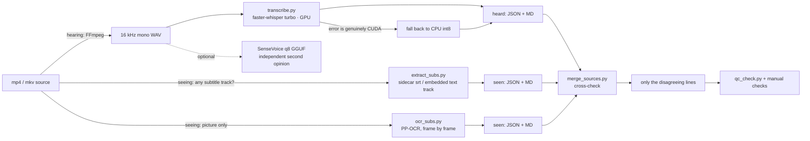

<h1 align="center">asr-transcription</h1>

<p align="center">
  <a href="./README.md">简体中文</a> | <b>English</b>
  <br><br>
  <a href="LICENSE"></a>
  <a href="https://www.python.org/"></a>
  
  
  <a href="https://github.com/ChenChen913/asr-transcription-skill/actions/workflows/tests.yml"></a>
</p>

An agent-loadable Chinese ASR skill: **hearing** (speech transcription) + **seeing** (subtitle tracks / on-screen OCR) + **cross-checking the two**, with 1485 offline assertions.

> [!NOTE]
> This repository is AI-assisted. Every script and number has been verified by hand, and the process is recorded in [`ROADMAP.md`](ROADMAP.md). Platforms that were not tested are never described as supported — see [Known limitations](#known-limitations).



With the dependencies installed, one audio file takes three commands:

```powershell
python -m pip install -r requirements.txt
python scripts/transcribe.py --wav "01.wav" --model "<model-dir>" --out "out/01.json" --tag "01"
python scripts/qc_check.py "out/01.json"
```

Full prerequisites and the environment check are in [Quick start](#quick-start).

## Table of contents

- [Why this project](#why-this-project)
- [Two senses: hearing and seeing](#two-senses-hearing-and-seeing)
- [Quick start](#quick-start)
- [Usage](#usage)
- [Configuration](#configuration)
- [Project structure](#project-structure)
- [Development](#development)
- [FAQ](#faq)
- [Known limitations](#known-limitations)
- [Third-party projects and licenses](#third-party-projects-and-licenses)
- [Contributing](#contributing)
- [License](#license)

## Why this project

It started with real transcription work, not with a framework looking for a use case. Turning a batch of Chinese talking-head videos into verbatim transcripts, and trying several stacks along the way, made one thing clear: failures rarely come from the model itself.

- The opening prompt gets read aloud into the transcript
- The ending invents sign-off lines such as "thanks for watching"
- A whole passage in the middle disappears, invisible in the output
- cuBLAS / cuDNN DLLs cannot be found even though the files are on disk
- `--json` redirected to a file becomes GBK bytes, no longer valid JSON

Switching models does not fix any of these. They are process problems: how versions are pinned, how parameters are set, how output is verified, and whether numbers can be generalised. That is why this repository is about process, not models.

The scripts automate four things: environment check, single-file transcription, batch transcription, and transcript QC. Judgement stays with the human and the agent: listen to the first and last 30 seconds, cross-check long gaps, and never claim an accuracy figure without a reference transcript.

Three rules are written into `SKILL.md`, and repeated here:

1. **Always run the three checks after transcribing**: the first 30 seconds, the last 30 seconds, and any gap longer than 8 seconds. Passing all four numeric metrics does not exempt you.
2. **Never report accuracy without a trustworthy reference**: character error rate needs a human transcript or official subtitles. On-screen subtitle OCR is supporting evidence only. A difference score is not accuracy.
3. **Two versions of the same family are not two pairs of eyes**: turbo is a decoder-pruned large-v3 and shares the encoder, so their errors correlate. An independent second opinion requires a different architecture.

What it is not: it does not train models, publish weights, run a cloud service, or contain any audio. The repository holds process, scripts, and attribution.

## Two senses: hearing and seeing

Two independent routes to the same words, and they fail differently:

| | Hearing (`transcribe.py`) | Seeing (`extract_subs.py` / `ocr_subs.py`) |
|---|---|---|
| Input | The audio track | A subtitle track, or the pixels |
| Strength | Covers the whole clip, real sentence boundaries, natural punctuation | Proper nouns, jargon and numbers are usually right; the punctuation is the author's |
| Typical failure | Homophones: `RAG`→`RAW`, `Rerank`→`RUNK` | Look-alike characters, dropped characters: `懵逼`→`憎逼`; titles and watermarks read as dialogue |

A real pair from one clip (`懂王AI面试合集` #66, 183 s):

- heard: `TOPK出牌, RUNK金牌, 大模型` / seen: `Top K粗排, Rerank精排, 大模型` — seeing wins this one
- heard: `蒙逼了` / seen: `憎逼了` — hearing wins this one

A full run over 25 real interview clips (2026-11-06, 48.7 minutes, none with a subtitle track):

- **Hearing produced a transcript for all 25, zero failures**; seeing managed 24, and the odd one out genuinely has no text on screen — refusing was correct.
- **English proper nouns are where hearing breaks**: `RAG` came out as `RIG` / `REG` **32 times**, versus 0 for seeing; `DeepSeek`, `LangChain` and `Claude` were **never once spelled right** by hearing, while seeing got them 6 / 6 / 4 times.
- **Chinese look-alike characters are where seeing breaks**: OCR turned `Agent` into `a整` / `急诊` **15 times**, against 2 for hearing.
- Median cross-check similarity falls from **0.90** (talking head with synced subtitles) to **0.64** (busy animated captions). The dirtier the picture, the more false disagreements.

The resulting default: **hearing writes the draft, seeing only corrects proper nouns and numbers**; where seeing has no coverage, an English term list is the only backstop.

So the answer is not to pick a side, and not to blend both into one file. It is three steps:

1. **Hear first**: produce a timestamped transcript. It covers the whole clip and has sentence structure; it is the closest thing to a script.
2. **See second**: pull the subtitle track, or OCR the picture when there is none. It is independent evidence, not a patch for the transcript.
3. **Cross-check last**: `merge_sources.py` aligns the two and lists only where they disagree, or where one side has nothing. A human reads those few blocks instead of both documents.

The cross-check also answers two questions along the way: how many seconds the subtitles lag the speech (routine in edited short videos), and which numbers or terms are written differently on each side.

## Quick start

### Prerequisites

| Item | Requirement |
|---|---|
| OS | Windows 11 (the only tested platform; other platforms in [Known limitations](#verified-platforms)) |
| Python | 3.13.x (3.13.14 measured on 2026-11-06) |
| FFmpeg | `ffmpeg` and `ffprobe` on `PATH` |
| GPU (optional) | NVIDIA, CUDA 12.x / cuDNN 9, at least 8 GB VRAM; without one, add `--device cpu` |
| Model | A CTranslate2 directory with 5 files: `config.json` / `model.bin` / `preprocessor_config.json` / `tokenizer.json` / `vocabulary.json` |
| Disk | turbo about 1.51 GiB, large-v3 about 2.88 GiB |

Model weights are **not** in this repository; download them yourself (Hugging Face or a mirror). Without a model, `check_env.py` and all six test suites still run.

### Install

```powershell
git clone https://github.com/ChenChen913/asr-transcription-skill.git "$env:USERPROFILE\.workbuddy\skills\asr-transcription"
cd "$env:USERPROFILE\.workbuddy\skills\asr-transcription"
python -m pip install -r requirements.txt          # hearing: faster-whisper / CTranslate2 / av
python -m pip install -r requirements-ocr.txt      # seeing: only ocr_subs.py needs this, optional
```

Versions are pinned in those files (`faster-whisper==1.2.1`, `ctranslate2==4.8.1`, `av<19`; OCR side `rapidocr-onnxruntime==1.2.3`, `onnxruntime==1.24.2`, because rapidocr 2.x changed its result schema).

### Download the models

Both live in plain local folders; point `--model` at one.

```powershell
python -m pip install huggingface_hub
# Behind the GFW, set the mirror first: $env:HF_ENDPOINT = "https://hf-mirror.com"

hf download mobiuslabsgmbh/faster-whisper-large-v3-turbo `
  --local-dir D:\hf-models\faster-whisper-large-v3-turbo     # 1.51 GiB, the workhorse
hf download Systran/faster-whisper-large-v3 `
  --local-dir D:\hf-models\faster-whisper-large-v3           # 2.88 GiB, hard-case review only
```

> `hf` is the huggingface_hub 1.x command; on 0.x it is `huggingface-cli download` with the same arguments. `mobiuslabsgmbh/faster-whisper-large-v3-turbo` is the CTranslate2 turbo repo registered in faster-whisper itself; the community `deepdml/faster-whisper-large-v3-turbo-ct2` also works but is a different conversion.

Then check the environment. `check_env.py` is read-only and writes nothing, and **exits 1 when a dependency, ffmpeg, or a model is missing**, so it can gate CI; `run_smoke.py` needs no model, GPU, or network:

```powershell
python scripts/check_env.py --models "<model-dir>"
python tests/run_smoke.py
```

### Run your first transcript

```powershell
# 1. Normalise to 16 kHz mono PCM WAV
ffmpeg -y -i "<source>.mp4" -vn -ac 1 -ar 16000 -c:a pcm_s16le "01.wav"

# 2. Transcribe; falls back to CPU only when the error is genuinely CUDA
python scripts/transcribe.py --wav "01.wav" --model "<model-dir>" --out "out/01.json" --tag "01"

# 3. QC
python scripts/qc_check.py "out/01.json"
```

Look at three things afterwards: `out/01.json` (structured), `out/01.md` (timestamped readable version), and the `device` field in the JSON (`cuda` or `cpu`). **Do not trust the `--device` flag alone** — the device that actually ran is recorded in the output.

### Without the Skill mechanism

The scripts are plain Python 3: put the repository anywhere and call `python scripts/transcribe.py ...`; no agent runtime required. Only two carry dependencies — `transcribe.py` needs faster-whisper / CTranslate2 plus a model, `ocr_subs.py` needs `rapidocr_onnxruntime` and `onnxruntime`; the other five are standard library only. A missing dependency is named explicitly rather than degrading silently.

To load it as a Skill in another agent tool, follow that tool's documented directory and metadata conventions. **Only the WorkBuddy user-level Skill path has been tested here; this repository does not claim compatibility with other tools.**

## Usage

### How much is automated

| Step | Owner | Where |
|---|---|---|
| Environment check | Automated | `scripts/check_env.py` |
| Subtitle track extraction (seeing) | Automated | `scripts/extract_subs.py` |
| On-screen subtitle OCR (seeing) | Automated, needs the OCR runtime | `scripts/ocr_subs.py` |
| Single-file transcription (hearing) | Automated | `scripts/transcribe.py` |
| Batch transcription | Automated | `scripts/batch_transcribe.py` |
| Transcript QC | Automated | `scripts/qc_check.py` |
| Hearing/seeing cross-check | Automated | `scripts/merge_sources.py` |
| Regression tests | Automated | the six suites under `tests/` |
| Audio extraction, cross-engine comparison, diff alignment, editing, record keeping | Agent workflow | The Skill tells the agent which command to run and how to read the result; no script |
| Listening to first/last 30 s, glossary, reference transcript, licence review | Manual | Requires human judgement |

> "The workflow is documented" does not mean "the tool implements it". SenseVoice q8 GGUF has commands but no wrapper script; it is an optional independent comparison.

### Subtitle track extraction

When the source already carries subtitles, start here: no inference, no model load, seconds per file.

```powershell
python scripts/extract_subs.py --input "01.mp4" --out-dir "out" --list   # list tracks only
python scripts/extract_subs.py --input "01.mp4" --out-dir "out"          # sidecar srt first, then embedded text track
python scripts/extract_subs.py --input "01.mp4" --out-dir "out" --lang zh
```

The output uses the **same schema** as transcription (`out/01.json` + `out/01.md`), plus `out/01.srt` as an archival copy; the JSON carries `"engine": "subtitle-track"`. Only **text** tracks are handled: PGS / VobSub and friends are refused with an explicit "needs OCR" message, and burned-in subtitles are out of scope. The container duration is probed even on the sidecar path, so a partial sidecar cannot report the video as shorter than it is. Exit code `3` means nothing was extracted — proceed with transcription.

> A subtitle is not a verbatim transcript: authors drop filler words, merge sentences and bring their own punctuation. The MD header says so, and `qc_check.py` skips the character/segment density warnings for this source — overlaps, long gaps and closing phrases are still checked.

### On-screen subtitles (OCR)

Use this when the subtitles are burned into the pixels and no text track exists. The OCR runtime has to be installed first (~13 MB of models ship inside the wheel; nothing else to download):

```text
python -m pip install -r requirements-ocr.txt
```

```text
# probe first: is there a burned-in band at all? (16 frames, seconds)
python scripts/ocr_subs.py --input "01.mp4" --list

# then read every sampled frame, same schema out
python scripts/ocr_subs.py --input "01.mp4" --out-dir "out" --fps 1.0
```

The band is not guessed: it is **derived from the boxes OCR itself returns**, in three steps:

1. Keep only boxes at or above the 60th height percentile *of this clip*. The dozens of UI lines in a screen recording drop out here, and because the cut is a percentile it needs no per-resolution threshold.
2. Score a ±5% window around each box centre: `support × min(distinct texts, 8) × size weight`. Text that never changes (logo, watermark, fixed title) scores near zero and drops out on its own.
3. Tighten to subtitle-sized boxes (`h ≥ 0.6 × median line height`) and keep 5% of the frame height above and below before cropping.

That third step is not slack, it is **required**: PP-OCR's detector needs vertical context around a line, and a crop that lands on the glyph outline makes it read a whole line as a fragment — on one frame `Topk要用最小的值获得` came back as `doL` with 1.2% padding and read correctly with 5%.

Yellow subtitles therefore need no special case — they are just text, not a colour problem.

**A band, though, usually holds more than one line.** Locating it only answers "where is there text"; it says nothing about *which line is being spoken*. Two other kinds turn up in real clips and both ruin the transcript:

- **Bilingual subtitles**: the translation is printed under the dialogue and both lines change in step, so nothing in the picture says which one was said. `--language` decides (default `zh`): keep Chinese, drop the translation. Keeping it is expensive — measured 692 → 2816 characters, and the English dragged `merge_sources.py` similarity down far enough that nearly every pair came out contradictory.
- **Set-dressing**: bullet blocks, chapter labels and flowcharts sit inside the band at the same font size. The only difference is **how fast they change** — dialogue is replaced every second, a bullet block every ten or twenty. So a *run* is dropped when it holds for too many consecutive frames: measured 2 frames for dialogue against 9–17 for the block under it. The unit is the run, not the position: one slot held a chapter card for 17 seconds and flashed a real line of dialogue in between, and the line survives (measured: `发票要寄到上海办公室`). Two guards: something else must be changing at least 2.5× faster, and the drop never goes below a five-second floor, so a clip of slow lyrics loses nothing. **A diagram that animates every frame still gets through** — it changes as fast as speech; 7 cues out of 25 clips.

Both the drops and the language choice are written into the report header and `params` — nothing disappears quietly.

By default it reads only the lower half (`--region 0.50,0.995`) at 1 fps. The cost is real: about 0.38 s per frame, so a 3-minute clip takes roughly a minute — slower than transcribing it. That is why this is an **on-demand second opinion**, not the default path. Exit code `3` means no file had a readable subtitle band.

> The earlier pure-Pillow plan (bright, low-saturation pixels projected onto rows) was dropped: on the same clips a white shirt scored 117.8, higher than the real subtitle band, and the "saturation ≤ 70" gate excluded yellow text outright. The decision is recorded under v0.7 in `ROADMAP.md`.


### Single file

```powershell
python scripts/transcribe.py `
    --wav "01.wav" --model "<model-dir>" --out "out/01.json" --tag "01" `
    --device cuda --compute float16
```

The fallback has a precondition: it only switches to CPU when the error matches `cuda / cublas / cudnn / cudart / nvml / gpu / out of memory / no kernel image`. A corrupt model, an undecodable file, or an invalid argument does not trigger it — CPU would fail the same way and the real error would be buried. Disable fallback with `--no-fallback`.

| Exit code | Meaning |
|---|---|
| `0` | Success |
| `2` | Input or model directory unusable |
| `3` | The current device failed and no fallback was attempted |
| `4` | Both GPU and CPU failed |

### Batch

One folder, or several:

```powershell
# Plan first: no model loaded, nothing written
python scripts/batch_transcribe.py --input "<dir-a>" "<dir-b>" --out-dir "out" --dry-run

# Then run
python scripts/batch_transcribe.py --input "<dir-a>" "<dir-b>" --out-dir "out" --model "<model-dir>"
```

It does exactly four things:

1. **Serial**: one model instance at a time. GPU and CPU runs never overlap, so resource readings stay clean.
2. **Skips finished files**: the unit is the pair of artefacts (JSON + MD), not a single file.
3. **Isolates failures**: a non-zero exit or a timeout on one file is recorded and the batch continues.
4. **One output pair per input**: same schema as a single run, ready for `qc_check.py`.

Layout of `--out-dir`:

```text
out/
├── <key>.json          one structured transcript per input
├── <key>.md            the readable version
├── <key>.json.prev     only while a re-run is in flight, or if it failed
├── <key>.md.prev
└── _batch/summary.json counts + per-file outcome, rewritten after every file
```

Two things that bite:

- **`json` and `md` are one deliverable.** The skip rule requires both to be complete, and `--force` moves both aside as `.prev`. The writer renames the MD before the JSON, so "JSON exists ⇒ MD exists"; a task killed halfway is retried next run instead of being skipped forever.
- **Non-WAV inputs are decoded for you.** Matched `.mp4/.mov/.mkv/.m4a/.mp3/.flac/...` files are converted to 16 kHz mono WAV with ffmpeg into `_batch/audio/` and reused on retry (`--force` re-decodes). A batch of WAV files never touches ffmpeg, so it still runs on a machine without it; when a non-WAV is matched and ffmpeg is missing, the batch stops before running with exit 2 instead of failing one file at a time.

Exit codes: `0` all succeeded | `1` failures or timeouts | `2` usage or match error, or a non-WAV match without ffmpeg.

### QC

```powershell
python scripts/qc_check.py "out/*.json"
python scripts/qc_check.py "out/*.json" --json      # strict JSON, CI-friendly
```

A real run (synthetic sample, shown for the grading):

```text
--- demo.json [REVIEW]
    (62.40s, 34 chars, 3 segs)
    punct/100=11.76  chars/min=32.7  segs/min=2.9  maxgap=10.50s  tail=38.40s  overrun=-38.40s
    [RED/REVIEW] LONG GAP 10.50s at 9.6-20.1s
    [warn] tail gap 38.40s > 10.0s (possible truncation)
    [warn] char density 32.7/min outside (200.0, 450.0)
```

| Marker | Meaning | Action |
|---|---|---|
| `[ERROR]` / `"errors"` | A deterministic input problem: missing field, non-numeric, `NaN` / `Infinity`, negative value, out-of-order segments, invalid `duration` | Fix the input or the producing script. **This is not "the transcript is wrong"** |
| ↳ invalid timeline | Negative start / `end < start` / out of order: parseable numbers, but no valid timeline | The three time metrics become `null`, `has_timestamps=false`, `note` says `INVALID TIMELINE`; text metrics still work |
| `[RED/REVIEW]` / `"red"` | Risk signal: overlap, empty text, overrun, long gap, prompt echo, no timestamps | Inspect that interval by hand. **Not proof of an error** |
| `[warn]` | A coarse metric is out of range: character density, segment count, tail gap | Reference only; does not affect the exit code |

Thresholds are strict: `gap > 8.00 s` (8.00 passes, 8.01 fails) and `overrun > 0.50 s`. Adjust with `--gap` / `--tail`. In both text and `--json` mode, the exit code is 1 when there is any ERROR or RED.

### Hearing/seeing cross-check

Once both documents exist, do not diff them by hand:

```text
python scripts/merge_sources.py --heard "out/01.json" --seen "out/01-ocr.json" --out "out/01.merge.md"
```

It aligns the two by time and scores each pair, sorting the result into five buckets: agree / near / differ / heard-only / seen-only. The MD lists **only the blocks a human has to read**, worst first, with both texts side by side plus any term or number that appears on one side only. The same-named `.json` carries the full set.

Four deliberate designs:

- **No "merged transcript"**. Both sides are unreliable; blending them only makes a less reliable document that can no longer be checked.
- **A differing number is always `differ`**, even when the sentence scores 0.95 — `K=50` vs `K=60` is invisible to both homophone and glyph similarity.
- **The time offset is measured first**. Subtitles in short edited videos routinely trail the speech by a second or two; without correcting for it every block would be misread as a conflict. The offset is reported, but **neither side's original timestamps are ever changed**.
- **A different sentence split is not a contradiction**. One cue often covers two spoken sentences, which drags the whole-sentence score down and looks like an error. The script instead checks how much of the shorter side can be found in the longer one: at ≥ 80% it drops to `near` and says why — unless what is missing is a number, which still counts as `differ`.

### Output format

The JSON from `transcribe.py` has segment-level timestamps only, no word-level `words`:

| Field | Meaning |
|---|---|
| `tag` / `engine` / `model` | Task label, engine, model directory name |
| `device` / `compute` | Device and precision actually used; `cpu` after a fallback |
| `duration` | Audio duration in seconds |
| `segments[]` | `s` / `e` / `t` per segment: start, end, text |
| `stats` | `chars_per_min` / `segs_per_min` / `punct_per_100` / `max_gap_s` / `tail_gap_s` |
| `load_s` / `asr_s` / `rtf_x` | Load time / pure inference time / real-time factor. `asr_s` excludes loading |
| `fallback` / `fallback_load_s` | Non-null means a fallback happened, with the original exception; the latter is the load time already spent on the failed attempt |
| `error` | Failure reason, `null` on success |

### The three post-run checks

| Check | How to judge |
|---|---|
| First 30 s | Is the prompt read aloud into the text? Did an intro line slip in? Was the real opening swallowed whole? |
| Last 30 s | Any invented "thanks for watching"? Does the last segment end after the audio duration? |
| Long gaps | Any gap > 8 seconds: listen back, or compare that interval against the other engine |

A negative "tail gap" is not a pass; it means hallucinated segments were added. These are hard checks, not reference values.

## Configuration

There is **no config file, no API key, and no account**. Every parameter is a CLI flag. The only environment variable the scripts read is `PATH` (`transcribe.py` uses it to locate CUDA DLL directories).

### extract_subs.py

| Flag | Default | Meaning |
|---|---|---|
| `--input` | required | One or more media files / directories |
| `--out-dir` | required | Output directory (`<key>.json` / `.md` / `.srt`) |
| `--stream` | auto | Take the N-th subtitle stream (0-based, as a human counts) |
| `--lang` | auto | Accept only a text track in this language; refuse rather than switch silently |
| `--no-sidecar` | off | Ignore a same-stem `.srt/.ass/.ssa/.vtt` |
| `--recursive` | off | Descend into subdirectories |
| `--list` | off | List tracks, extract nothing |
| `--force` | off | Re-extract even if output exists |
| `--timeout` | `120` | Per ffmpeg / ffprobe call, seconds |
| `--ffmpeg` / `--ffprobe` | PATH | Explicit binaries |

### ocr_subs.py

| Flag | Default | Meaning |
|---|---|---|
| `--input` | required | One or more video files / directories |
| `--out-dir` | not needed with `--list` | Output directory (`<key>.json` / `.md`) |
| `--fps` | `1.0` | Sampled frames per second; runtime is strictly proportional |
| `--region` | `0.50,0.995` | Vertical search window, as a fraction of frame height |
| `--min-score` | `0.5` | Lines below this confidence are dropped outright |
| `--language` | `zh` | Which line to keep in a bilingual subtitle: `zh` keeps Chinese and drops the translation, `en` the reverse. If nothing matches, everything is kept — a wrong flag never yields an empty transcript |
| `--no-band` | off | Skip band detection and read the whole `--region` (debugging only; it reads titles and watermarks too) |
| `--calib-frames` | `16` | Sample frames used to locate the band |
| `--max-frames` | `900` | Frame cap; beyond it the fps is lowered automatically and the output says so |
| `--list` | off | Probe for burned-in subtitles, write nothing |
| `--recursive` / `--force` / `--timeout` / `--ffmpeg` / `--ffprobe` | as `extract_subs.py` | Recursion, re-run, timeout, binaries |

### merge_sources.py

| Flag | Default | Meaning |
|---|---|---|
| `--heard` | required | The heard JSON (`transcribe.py` output) |
| `--seen` | required | The seen JSON (`extract_subs.py` or `ocr_subs.py` output) |
| `--out` | required | Report `.md` path; the same-named `.json` goes beside it |
| `--agree` | `0.85` | Similarity at or above this counts as agreement |
| `--near` | `0.55` | At or above this is "near"; below is "differ" |
| `--limit` | `40` | Max blocks in the MD (the JSON has everything) |
| `--title` | the heard tag | Report title |

### transcribe.py

| Flag | Default | Meaning |
|---|---|---|
| `--wav` | required | 16 kHz mono PCM WAV |
| `--model` | required | CTranslate2 directory (5 files) |
| `--out` | required | Output `.json` path; the `.md` is written next to it |
| `--tag` | empty | Task label; defaults to the output file name |
| `--device` | `cuda` | `cuda` or `cpu` |
| `--compute` | automatic | `float16` on `cuda`, `int8` on `cpu` |
| `--language` | `zh` | Recognition language |
| `--beam-size` | `5` | Beam width |
| `--min-silence` | `300` | VAD (voice activity detection) minimum silence, ms |
| `--no-vad` | off | Disable VAD |
| `--no-prompt` | off | Disable `initial_prompt`. **Ablation only, never for production**: punctuation density collapses without it |
| `--hallucination-silence-threshold` | unset | Passed through to faster-whisper |
| `--cpu-threads` | `8` | CPU thread count |
| `--no-fallback` | off | Never fall back; report the CUDA error as-is |

### batch_transcribe.py

| Flag | Default | Meaning |
|---|---|---|
| `--input` | required | One or more directories, or explicit files |
| `--out-dir` | required | Output directory; also holds `_batch/summary.json` |
| `--model` | empty | May be omitted with `--dry-run` |
| `--pattern` | WAV plus common video/audio containers | File-name pattern, case-insensitive; non-WAV matches are decoded with ffmpeg, and a missing ffmpeg aborts before the run |
| `--recursive` | off | Descend into subdirectories |
| `--force` | off | Re-run even when output exists |
| `--dry-run` | off | Print the plan only |
| `--timeout` | `1800` | Per-file timeout in seconds |
| `--device` / `--compute` / `--language` | same as single run | Passed through to `transcribe.py` |

### qc_check.py and check_env.py

| Flag | Default | Meaning |
|---|---|---|
| `qc_check.py files...` | required | JSON files or glob patterns |
| `qc_check.py --gap` | `8.0` | Long-gap threshold, strictly greater-than |
| `qc_check.py --tail` | `10.0` | Tail-gap warning threshold |
| `qc_check.py --json` | off | Machine-readable output |
| `check_env.py --models` | none | Model directories to verify, one or more |
| `check_env.py --json` | off | Machine-readable output |

## Project structure

```text
asr-transcription/
├── SKILL.md                  # entry point (106 lines): trigger, workflow, routing, three rules
├── README.md / README_EN.md  # this file and the Chinese original
├── ROADMAP.md                # version log, deferred items, red lines, release checks
├── NOTICE.md                 # scope of the licence and third-party attribution
├── LICENSE                   # MIT
├── references/               # 10 files, routed by problem, one at a time
│   ├── 01-selection.md       # engine choice, five questions, reference numbers
│   ├── 02-workflow.md        # standard workflow, sources, batch engineering
│   ├── 03-parameters.md      # parameters, GPU DLLs, fallback, version pins
│   ├── 04-quality.md         # QC, three checks, references, hallucination shapes
│   ├── 05-vocabulary.md      # proper nouns
│   ├── 06-environment.md     # environment, resource guardrails, installs
│   ├── 07-pitfalls.md        # pitfall list
│   ├── 08-methodology.md     # methodology limits, open questions
│   ├── 09-attribution.md     # full third-party attribution
│   └── 10-commands.md        # command cheat sheet (bash + PowerShell)
├── scripts/
│   ├── extract_subs.py       # seeing: pull an embedded text subtitle track, same schema
│   ├── ocr_subs.py           # seeing: burned-in subtitles via PP-OCR, frame by frame
│   ├── merge_sources.py      # cross-check the two sides, list only the conflicts
│   ├── transcribe.py         # hearing: transcription, JSON + MD
│   ├── batch_transcribe.py   # serial batch runner
│   ├── qc_check.py           # validation + four coarse metrics + three checks
│   └── check_env.py          # read-only environment check
├── tests/                    # six zero-dependency suites, 1485 assertions
└── docs/
    ├── 转写经验_通用版.md      # the original long-form notes; references win on conflict
    ├── 字幕识别与OCR_调研与设计.md  # three routes and measurements; the track part shipped as v0.6
    └── 参考项目评估_native-subtitle-quote-image.md  # upstream evaluation: band detection, frame diffing
```

Three loading levels: `name` + `description` always resident → `SKILL.md` on trigger → one `references/` file on demand. Scripts execute directly; they never need to enter the context window.

## Development

### Tests

```powershell
python -m compileall -q scripts tests
python tests/run_smoke.py            # QC contract: 37 inputs x text/JSON
python tests/run_transcribe_unit.py  # fallback decision, timing semantics, atomic output
python tests/run_batch_unit.py       # batch planning, skip rule, end-to-end
python tests/run_subs_unit.py        # subtitle parsing, track choice, sidecar fallback
python tests/run_ocr_unit.py         # text cleanup, band detection, cue merging
python tests/run_merge_unit.py       # alignment, similarity tiers, time offset, report shape
```

Actual output (2026-11-06):

```text
40 cases x (text + --json), 1104 assertions, 0 failures.
43 assertions, 0 failures.
102 assertions, 0 failures.
79 assertions, 0 failures.
73 assertions, 0 failures.
58 assertions, 0 failures.
```

None of the six needs network, a model, a GPU, or ffmpeg. The batch end-to-end case drives `main()` with a fake `transcribe.py`, covering success, failure, skipping, retry after a fix, and half-written artefacts; the subtitle suite points `ffprobe` at a missing binary to prove a sidecar still produces a transcript without a probe; the OCR and cross-check suites only touch pure functions, so they run with or without the OCR runtime installed.

### The "false green" trap on Windows

The test harness injects `PYTHONUTF8=1` and `PYTHONIOENCODING=utf-8` into child processes. Without them, a Chinese Windows console decodes as GBK and tests fail on encoding rather than logic. The price: **green here does not mean green in a clean environment**.

For any change touching the console or child processes, clear both variables and run again before committing:

```powershell
Remove-Item Env:PYTHONUTF8, Env:PYTHONIOENCODING -ErrorAction SilentlyContinue
python tests/run_smoke.py
```

### Red lines

1. **Never break existing `--json` keys**: `error` / `red` / `warn` / `duration` / `has_timestamps` / `note` and all metric keys stay. New fields are additive only.
2. **No new dependencies, no network, no uploading material**: tests must stay zero-dependency and repeatable offline.
3. **No audio, model weights, transcripts, credentials, or absolute local paths in the repository.**
4. **Keep `SKILL.md` lean** (106 lines): details go to `references/`, architecture to `README.md`, planning to `ROADMAP.md`.
5. **ERROR ≠ wrong transcript**: ERROR is an input-data problem; RED needs human review. Neither may be described as "the transcription was wrong".

More in [`ROADMAP.md`](ROADMAP.md) section 3 and [`references/08-methodology.md`](references/08-methodology.md).

## FAQ

**Q: `check_env.py` sees the DLLs, but running fails with `cublas64_12.dll not found`.**
A: Existing files do not mean loadable. cuBLAS / cuDNN usually live under the **user-level** `site-packages`, not the interpreter directory. Check `python -c "import site; print(site.getusersitepackages())"`, then confirm that directory is on `PATH`. If it still fails, run one real inference instead of trusting a file listing.

**Q: `pip install av` pulled 19.x and `decode_audio` now fails.**
A: Pin `av<19`. faster-whisper 1.2.1 does not ship PyAV 19 support (upstream main has the fix, but it is not in that release). Python 3.14 is out of scope for the same reason.

**Q: Why is there no `--word-timestamps`?**
A: `transcribe.py` emits segment-level `s` / `e` / `t` only and never writes `words`. A flag that changes decoding but not output would make people believe they have word timestamps, so it was removed. Word timestamps, speaker diarisation, and SRT export are item C3 in `ROADMAP.md`, unscheduled.

**Q: `--json` redirected to a file is unreadable by other tools.**
A: Since v0.4.3, non-TTY output is forced to UTF-8. Older versions emitted GBK bytes on Chinese Windows, which is not valid JSON. Upgrade to v0.4.3 or later; TTY output still uses the local code page, so the screen is unaffected.

**Q: I hit Ctrl+C halfway through a batch. Will a re-run transcribe everything again?**
A: No. The rule is the artefacts themselves: `<key>.json` parses, has no `error`, contains `segments` and `duration`, and `<key>.md` exists and is non-empty. Finished pairs are skipped; a file with JSON but no MD is retried.

**Q: One file failed, yet later runs keep skipping it.**
A: Fixed in v0.5.1. `--force` now moves both the JSON and the MD aside as `.prev`, so a failed run leaves no stale artefacts and the next run retries. On v0.5 or older, delete the stale `.json` and `.md` once.

**Q: Can you give me an accuracy number?**
A: No. Accuracy needs a human-verified reference transcript as the denominator. Without one, this project reports where two engines disagree plus manual spot checks. On-screen subtitle OCR is supporting evidence only, never ground truth.

**Q: Does it accept mp3 / m4a?**
A: Yes, through `batch_transcribe.py`: non-WAV matches are decoded to 16 kHz mono WAV with ffmpeg into `_batch/audio/` first. A single `transcribe.py` run still wants WAV, because it measures duration with the stdlib `wave` module — convert once with `ffmpeg -i in.m4a -vn -ac 1 -ar 16000 -c:a pcm_s16le out.wav`.

## Known limitations

### Verified platforms

| Environment | Status | Notes |
|---|---|---|
| Windows 11 + Python 3.13 + NVIDIA GPU (CUDA 12.x / cuDNN 9, ≥ 8 GB VRAM) | **Tested** | All scripts, the main pipeline, and the QC regression ran here |
| Same machine, CPU only (`--device cpu --compute int8`) | **Tested, single and batch** | About 2.6–2.9x real time; the QC regression set is GPU-heavy |
| Windows 10 / other NVIDIA GPUs / < 6 GB VRAM | Not tested | Verify against `references/06-environment.md`; use turbo or CPU when VRAM is short |
| Linux / macOS / AMD or Intel GPU | Not tested, do not copy the steps | DLL directories, PowerShell examples, and user-level `site-packages` paths are Windows-specific |
| Python 3.14 / PyAV 19 / torch-based stacks | Out of scope | Version pins in `references/03-parameters.md` |

### Capability boundaries

- **Segment-level timestamps only.** No word-level `words`, no speaker diarisation, no direct SRT / VTT export (the `.srt` written by `extract_subs.py` is the source track, not generated by transcription).
- **Seeing comes in two grades, both with edges.** `extract_subs.py` reads a sidecar `.srt/.ass/.ssa/.vtt` or an embedded **text** track with no inference (`engine=subtitle-track`); when there is none, `ocr_subs.py` reads the pixels frame by frame (`engine=ocr`). **Bitmap tracks (PGS/VobSub/DVB), vertical text, styled captions and occluded text are still unreadable**; OCR only searches the lower half, so subtitles at the top are never found. Nor can it separate text layered on the *same* line as the subtitle — splitting by vertical position separates lines, not the two pieces of text inside one line. What it can separate is furniture that sits on its own line and changes slower than the dialogue (bullet blocks, chapter labels, flowcharts): those are dropped by cadence, 50 runs across 6 clips; an animation that changes every frame still slips through (7 cues out of 25). It is slower than transcribing (~0.38 s per frame) and needs the OCR runtime — without it that one script fails loudly and the other five are unaffected.
- **Small text is read less reliably.** At 640×360 a line is a dozen pixels tall and the same cue reads differently under two crop paddings (measured agreement 0.815). The output is still usable, but the error rate is clearly higher than on a 720p/1080p vertical clip.
- **Hearing has almost no defence against English proper nouns.** Across 25 Chinese interview clips, `RAG` came out as `RIG` / `REG` **32 times**, and `DeepSeek`, `LangChain`, `Claude` were **never once spelled right**; OCR on the same clips got them 6 / 6 / 4 times. English abbreviations have to be corrected from the picture or a term list — an ASR-only draft will get them wrong.
- **Fast mixed Chinese/English speech can vanish wholesale.** One measured **17.66 s** stretch produced no text at all, with normal loudness (−18.2 dB, same as the surrounding minutes) and with VAD disabled, while the picture carried subtitles for exactly that span. Only the LONG GAP check in `qc_check.py` catches it, so long gaps must be re-listened — that is not optional.
- **Long films with long music-only shots make the decoder loop.** In a 158-minute film, 8 segments / 1066 characters were one phrase filling an entire 30 s window (the worst was 222 characters of "北京"); a 10-minute slice of an English film opened with 45 s of "不". Re-running that span alone with `--no-vad` merely swaps "不" for "呃" — VAD is not the cause. `qc_check.py` now reports a REPEAT LOOP with timestamp and size; mark those stretches unknown instead of trusting them. None of the 25 short interview clips showed it, so short material cannot expose this edge.
- **Cross-checking requires the same script on both sides.** With English audio and Chinese subtitles (heard 4% CJK, seen 96%), 0 of 98 pairs agreed and median similarity was 0.000. `merge_sources.py` now says plainly that the two sides use different writing systems and should each be used on their own, instead of suggesting they might be different files.
- **Two stacked lines need a wider crop, and that costs time.** Cropping tightly to the band makes PP-OCR fuse a Chinese line and its English translation into one box and read garbage; detecting over the whole lower half separates them, after which `--language` drops the translation (136 lines in one film, 342 in the other, and "这黑每幅画都过于万" becomes "这里每幅画都过千万"). The same 10-minute clip goes from 27 s to about 4.5 minutes. Single-line subtitles keep the fast path unchanged.
- **On-screen cards leak into documentary OCR.** Over 10 minutes of a documentary, OCR produced 46% more characters than ASR (1340 vs 916) and same-language cross-checking fell to a median 0.667 (about 0.90 on short interviews). The ceiling of cross-checking is set by the quality of "seeing".
- **Single-file failures leave no artefact.** Calling `transcribe.py` directly on a failing input produces nothing; only the exit code tells you. Batch covers it (`_batch/summary.json` records exit code and error tail); the single-file case is still C4 in `ROADMAP.md`.
- **No accuracy claims.** Without a human reference there is no number. That is a rule, not modesty.
- **SenseVoice is a second opinion only.** Its output has no usable timestamps, and it is clearly weaker on mixed Chinese/English proper nouns. It cannot produce a final transcript alone.
- **You download the models.** The repository contains no weights, no audio, and no credentials.
- **No directory-level report.** `_batch/summary.json` is per file; there is no cross-directory rollup.

### Limits of the performance numbers

| Setup | Real-time factor | RAM increase | VRAM increase | Final transcript alone |
|---|---|---|---|---|
| turbo / GPU | about 19x | about 1.2–1.6 GB | about 1.9–2.1 GB | Yes |
| large-v3 / GPU | about 6x | about 3.0–3.1 GB | about 3.8–3.9 GB | Yes, but expensive; review only |
| turbo / CPU | about 2.6–2.9x | about 1.4–1.5 GB | 0 | Slow |
| SenseVoice q8 GGUF / CPU | about 27–28x | about 0.36–0.37 GB | 0 | Preview / comparison / missing-segment hints |

Source: one machine, 2026-11-05, **4 clips** of Chinese speech (1.31 / 1.50 / 2.12 / 3.90 minutes), **9 configurations, 28 runs**, roughly ±30% variance. The sample is in the single digits, so these numbers indicate relative order only. **They are not a cross-machine benchmark** and do not extrapolate to meetings or read-aloud material. Long audio was measured separately on 2026-11-06: a 44.2-minute documentary took 91.9 s (28.9×) and a 158.5-minute film 172.8 s (55.0×), neither failed and VRAM did not grow with duration; both contain long music/silence stretches, so the higher ratio is not a speech-speed claim. Full table and definitions in `references/01-selection.md` section 1.7.

## Third-party projects and licenses

This repository trains and ships no models. It calls the projects below. **Code licences and model-weight licences are separate concerns**; check the current upstream repository and model card before commercial use. The full register, with verification dates and caveats, is in [`references/09-attribution.md`](references/09-attribution.md).

### Main pipeline

| Project / model | Maintainer | URL | Licence | Used for |
|---|---|---|---|---|
| OpenAI Whisper (`large-v3`, `large-v3-turbo` weights) | OpenAI | https://github.com/openai/whisper | MIT | Main model weights; turbo is a decoder-pruned large-v3 |
| faster-whisper | SYSTRAN | https://github.com/SYSTRAN/faster-whisper | MIT | Main engine and all transcription parameters |
| CTranslate2 | OpenNMT | https://github.com/OpenNMT/CTranslate2 | MIT | Inference backend for faster-whisper |
| PyAV (`av`) | PyAV-Org | https://github.com/PyAV-Org/PyAV | BSD-3-Clause | Audio decoding; pinned to `av<19` |
| CUDA / cuBLAS / cuDNN | NVIDIA | https://developer.nvidia.com/ | NVIDIA proprietary | GPU operator libraries |

### Supplementary and comparison (actually tested)

| Project / model | Maintainer | URL | Licence | Used for |
|---|---|---|---|---|
| SenseVoice / `SenseVoiceSmall` | QwenAudio (formerly FunAudioLLM; repo moved) | https://github.com/QwenAudio/SenseVoice | **Code MIT / weights `license: other` (FunASR Model License)** | CPU-only independent second opinion |
| FunASR | modelscope (Alibaba DAMO Speech) | https://github.com/modelscope/FunASR | MIT | GGUF runtime, VAD, punctuation, hotwords |
| FunASR llama.cpp runtime | modelscope/FunASR releases | https://github.com/modelscope/FunASR/releases | Ships with FunASR (MIT) | Windows binaries such as `llama-funasr-sensevoice.exe` |
| llama.cpp / GGUF | ggml-org | https://github.com/ggml-org/llama.cpp | MIT | q8 quantised model and runtime |
| sherpa-onnx | k2-fsa | https://github.com/k2-fsa/sherpa-onnx | Apache-2.0 | int8 ONNX comparison for SenseVoice / Paraformer |
| Paraformer | modelscope/FunASR (Alibaba DAMO) | https://github.com/modelscope/FunASR | Code MIT / weights per model card | "No punctuation" comparison; not recommended alone |

### Mentioned during selection, not adopted

| Project | Maintainer | URL | Licence |
|---|---|---|---|
| Qwen3-ASR | QwenLM (Alibaba Cloud Qwen team) | https://github.com/QwenLM/Qwen3-ASR | Apache-2.0 |
| WhisperX | `m-bain` (individual) | https://github.com/m-bain/whisperX | BSD-2-Clause |
| whisper.cpp | ggml-org | https://github.com/ggml-org/whisper.cpp | MIT |
| PyTorch / Transformers / vLLM | their respective organisations | official docs | per project; explicitly **not installed** here |

### Seeing: subtitles and OCR

| Project / model | Maintainer | URL | Licence | Used for |
|---|---|---|---|---|
| RapidOCR | RapidAI | https://github.com/RapidAI/RapidOCR | Apache-2.0 | Detection + recognition wrapper in `ocr_subs.py`, models included |
| PP-OCRv3 (`ch_PP-OCRv3_det` / `_rec` / `ch_ppocr_mobile_v2.0_cls`) | PaddleOCR team, Baidu | https://github.com/PaddlePaddle/PaddleOCR | Apache-2.0 | The three ONNX files shipped inside the RapidOCR wheel, 13.08 MB total |

Those three ONNX files are **weights**, used under the Apache-2.0 terms above; RapidOCR's wrapper code is Apache-2.0 as well. This repository redistributes no model files — `pip install` pulls them in.

### General tools and platforms

| Project | Maintainer | URL | Licence | Used for |
|---|---|---|---|---|
| FFmpeg / ffprobe | FFmpeg project | https://www.ffmpeg.org/ | LGPL / GPL depending on build | Audio extraction, source inspection |
| ONNX Runtime | Microsoft | https://github.com/microsoft/onnxruntime | MIT | Inference backend, including the OCR models |
| NumPy | NumPy community | https://numpy.org/ | BSD-3-Clause | Pulled in as a dependency by both inference paths |
| Pillow | Python Pillow contributors | https://python-pillow.org/ | MIT-CMU | Cropping and resizing frames before OCR |
| Hugging Face Hub / `hf-mirror.com` | Hugging Face / third-party mirror | https://huggingface.co/ | platform service, not a dependency | Model downloads |

### Licence boundary

- The MIT in `LICENSE` covers **only original content here**: documentation, scripts, and the Skill structure.
- Third-party model weights, engines, and runtimes are **not** covered; their rights stay with their maintainers.
- This repository contains **no** weight files (`*.bin` / `*.gguf` / `*.onnx`), audio, transcripts, or credentials.
- When redistributing, keep `LICENSE` and the attribution in `references/09-attribution.md`.

Attribution follows the official repository owner. Ownership moves (SenseVoice went from `FunAudioLLM` to `QwenAudio`), so re-check before use. Verified 2026-11-05 against the GitHub REST API and official model cards. **The SenseVoiceSmall weight licence could not be re-fetched from the HF API in that pass and reuses an earlier same-day check; open the model card before commercial use.**

## Contributing

Maintained by ChenChen913 as a personal project, with no commercial support.

- **Bugs and requests**: open an [issue](https://github.com/ChenChen913/asr-transcription-skill/issues). Include the command, exit code, the original error, and `check_env.py` output with local paths removed.
- **Pull requests**: welcome, but there is no fixed process and no promise of a timely review. Open an issue first so a large change does not get rejected on scope.
- **Before submitting**: all three suites green, and green again with `PYTHONUTF8` / `PYTHONIOENCODING` cleared (see [Development](#development)).
- **Do not commit**: model weights, audio, transcripts, credentials, or absolute local paths.
- **Do not add features just to support more models.** The goal is transcript quality and a reliable workflow, not model count.

## License

[MIT](LICENSE) © 2026 ChenChen913

`LICENSE` contains the standard MIT text only; the licence boundary and third-party attribution live in [`NOTICE.md`](NOTICE.md). Third-party projects remain the property of their maintainers, and this repository claims no rights over them.
