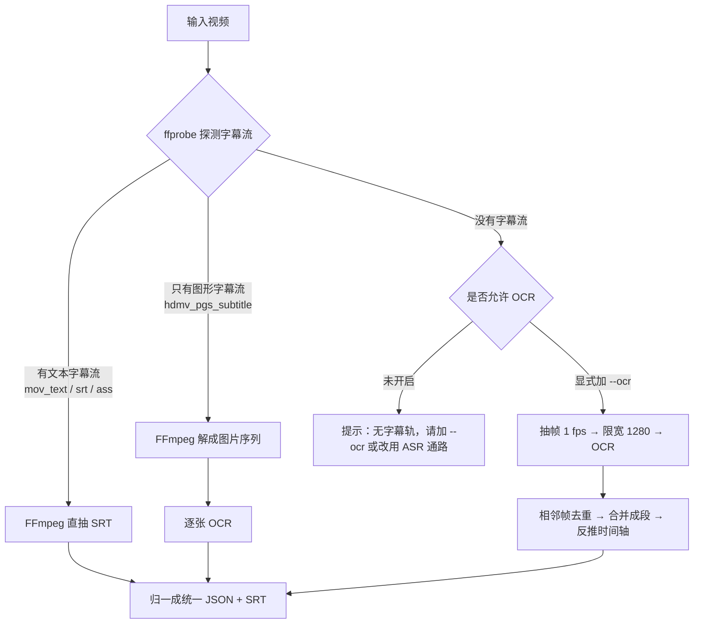

# 字幕识别与 OCR 通路 · 调研与设计

> **状态：部分实施。** 2026-11-06 的调研结论与设计方案；v0.6 已把第一条通路（**外挂/内嵌文本字幕轨**）落成 `scripts/extract_subs.py`，本文 §5–§8 关于硬字幕 OCR 的部分仍未实施。
> 硬字幕实施前需要先解掉 §9 里的两处红线冲突，并回答 §10 的三个决策问题。
>
> 适用对象：后续维护这个 Skill 的人（含未来的自己）。读完后应当能回答：为什么加、加在哪、为什么不是别的方案、哪些数字是实测的、哪些还没测。
>
> 相关：`docs/参考项目评估_native-subtitle-quote-image.md` 评估了上游项目 `native-subtitle-quote-image` 的可移植技术，其中「字幕带自动定位」与「帧差异度」两项会直接修订本文 §5.4 / §6.1 / §6.4 / §8.2。**该评估尚未合并进本文，四处修订待确认。**

---

## 0. TL;DR

| 问题 | 结论 |
|---|---|
| 现在有字幕识别能力吗？ | **没有，一行代码都没有。** 只有一段「用 OCR 验证转写质量」的方法学，用途完全不同（§2） |
| 要下载大模型吗？ | **不用。** PP-OCR 三个模型共 13.07 MB，已随 `rapidocr-onnxruntime` 装在 pip 包里，推理不联网（§3.2、§4.3） |
| 用什么技术？ | FFmpeg 抽帧 + PP-OCR（DBNet 检测 / CRNN 识别）+ ONNX Runtime CPU。**不引入 torch，不引入视频理解大模型**（§3） |
| 视频理解模型行不行？ | 不建议。它给的是画面描述，不是逐字 + 时间码；幻觉不可质检；且撞内存红线（§3.4） |
| 最划算的第一步是什么？ | **先抽字幕轨**（软字幕），零 OCR、时间码精确、零新依赖。抽不到再 OCR（§8） |
| 硬字幕 OCR 的坑在哪？ | 裸裁字幕带会**静默漏检**且更慢；整帧降采样到 1280 宽反而最快最准（§5.2） |

---

## 1. 问题是什么

### 1.1 三种「字幕」不是一回事

用户口中的「视频里有字幕」实际包含三种完全不同的东西，拿法、成本、可靠性差好几个数量级：

| 类型 | 容器/编码里的样子 | 典型来源 | 拿法 |
|---|---|---|---|
| **软字幕轨** | 独立字幕流：`mov_text`（MP4）、`subrip/srt`、`ass/ssa`（MKV） | 压制者手工嵌入、平台导出 | FFmpeg 直接解，**不需要 OCR** |
| **图形字幕轨** | 独立字幕流但是**位图**：`hdmv_pgs_subtitle`（蓝光）、DVD Sub | 蓝光原盘转制 | FFmpeg 解成图片序列，**逐张 OCR**；时间码自带 |
| **硬字幕（烧录）** | 不在流里，是画面像素的一部分 | 绝大多数国产视频、录屏、二次剪辑 | 抽帧 + OCR + 去重 + **重建时间轴** |

### 1.2 为什么必须分开做

- 软字幕轨是**人工做的**，时间码比 ASR 还准，成本却接近零。跳过它去做 OCR 是纯浪费。
- 图形字幕轨有现成时间码，OCR 只需逐张识别，不用管「这一帧属于哪一秒」。
- 只有硬字幕需要「抽帧 → 去重 → 反推时间轴」，也**只有它**会引入时间轴误差。

把三者混成一个功能，必然出现「明明有字幕轨却去跑 OCR，跑完时间轴还对不上」这种事故。

---

## 2. 现状核查（2026-11-06，以代码为准）

### 2.1 代码层：零命中

```bash
grep -rniE "ocr|subtitle|字幕|srt|vtt|ass\b|frame|视频|video" scripts/*.py tests/*.py
```

实际命中只有三类，**都与字幕无关**：

| 位置 | 内容 | 性质 |
|---|---|---|
| `qc_check.py:62,64` | `HEAD_WEAK = [..., "字幕由"]` | 幻觉关键词表（Whisper 会编「字幕由 XX 提供」） |
| `check_env.py:16` | `MODULES = [..., "rapidocr_onnxruntime"]` | **只探测装没装**，从不调用 |
| `batch_transcribe.py` / `check_env.py` | `subprocess`、`ffmpeg` | 转 WAV、查版本；**没有** `-map 0:s` 之类的字幕操作 |

### 2.2 文档层：有方法学，但用途相反

`references/04-quality.md` §5.2 / §5.5 已经写了一套 OCR 流程：按 1 fps 抽样、相邻帧相同则去重、必须先过质量门槛（字数比 + 内部重复率）。但它的定位是：

> 「**不是逐帧、更不是 ASR 的一步**」
> 「本手册**不推荐**把它当常规步骤」

即：**OCR 在这里是「尺子」，用来量转写的准确率；不是「产物」。** 这与用户想要的功能方向一致（都是抽帧 OCR），但下游完全不同——一个用于算字错率，一个用于输出 SRT。

### 2.3 环境层：依赖其实已经齐了

| 组件 | 本机版本 | 状态 |
|---|---|---|
| `rapidocr-onnxruntime` | 1.2.3 | 已装 |
| `onnxruntime` | 1.24.2（可用后端只有 `CPUExecutionProvider`） | 已装 |
| FFmpeg / ffprobe | `N-125829-gfe953596e9-20260728` | 已装 |
| `opencv-python` / `numpy` / `Pillow` / `shapely` / `pyclipper` / `PyYAML` | — | 已装（RapidOCR 的传递依赖） |

FFmpeg 本机可解的与字幕相关的编解码器：

```
ass / ssa                     ASS (Advanced SSA) subtitle（含编码器）
hdmv_pgs_subtitle             HDMV Presentation Graphic Stream（仅解码，位图）
mov_text                      MOV text
srt / subrip                  SubRip（含编码器）
```

### 2.4 结论

这不是「补一个脚本」，是**加一个新功能 + 改一条铁律**。`SKILL.md` 铁律 #2 现在写的是「画面字幕 OCR 只能做旁证」，功能落地后这句话必须改写，否则文档自相矛盾（见 §9.1）。

---

## 3. 技术选型

### 3.1 三层结构

| 层 | 组件 | 职责 |
|---|---|---|
| 解码 / 抽帧 | **FFmpeg**（外部进程，不是 Python 库） | 解容器、取字幕流、按 fps 抽帧、裁剪缩放 |
| 文字识别 | **PP-OCR 三个小模型**（经 RapidOCR 转成 ONNX） | 输出「框 + 文本 + 置信度」 |
| 推理 | **ONNX Runtime（CPU）** | 执行模型，无 GPU、无 torch |

### 3.2 三个模型各干什么、多大

模型就在 pip 包里，随包分发：

```
<site-packages>/rapidocr_onnxruntime/models/
```

| 文件 | 作用 | 体积 |
|---|---|---|
| `ch_PP-OCRv3_det_infer.onnx` | **检测**：DBNet，输出文字区域概率图，回归出文本框 | 2.32 MB |
| `ch_PP-OCRv3_rec_infer.onnx` | **识别**：CRNN + CTC，把每个框读成文字 | 10.20 MB |
| `ch_ppocr_mobile_v2.0_cls_infer.onnx` | **方向**：判断整行是否倒转 180° | 0.56 MB |
| | **合计** | **13.07 MB** |

包体总 13.2 MB。**推理时只读本地文件，不联网、不下载、不校验远端版本。**

### 3.3 和 Whisper 比是什么量级

| | 字幕 OCR | 转写主力 |
|---|---|---|
| 模型 | 13.07 MB | `faster-whisper-large-v3-turbo` 的 `model.bin` **1.51 GiB** |
| 倍数 | **1×** | **约 115×** |
| 架构 | 两组小卷积 + CTC | Transformer |
| 设备 | CPU | GPU（可回退 CPU） |

### 3.4 为什么不用「专门看视频的模型」

这是用户最初的想法，评估后不采用，理由按重要性排：

1. **任务错配**：视频理解模型（Qwen2.5-VL 这类）输出的是「画面里发生了什么」的自然语言描述，不是**逐字文本 + 精确起止时间**。拿它做不了 SRT，也做不了时间轴对齐。
2. **错误形态不可质检**：它编一句「谢谢大家观看」和真读到一句「谢谢大家观看」，在输出上无法区分。OCR 认错字会**带置信度**，能被阈值抓住（见 §3.6）。
3. **撞内存红线**：torch 系重依赖，本机可用运行内存常低于 6 GB，`SKILL.md` 硬约束明令不引入。
4. **性价比**：「读画面上的字」这件事工业标准做法就是抽帧 + OCR。用 VLM 属于拿大炮打蚊子，且打不准。

> 保留一种可能的辅助用途：用 VLM 判断「这个视频到底有没有字幕条」。但这属于锦上添花，本机显存条件下不划算，暂不考虑。

### 3.5 为什么不用 Windows 自带 OCR

Windows 10+ 有 `Windows.Media.Ocr`，理论上零安装。不采用：

- 需要额外装 `pywinrt` 绑定，且依赖系统语言包（中文包没装就用不了）——「零安装」并不成立。
- 只擅长单行短文本，无置信度输出，版式复杂时结果不可控。
- 跨机器行为不一致，与「本机实测、换机器先复核」的维护方式冲突。

### 3.6 错误形态：为什么 OCR 反而更好管

| | OCR | ASR / VLM |
|---|---|---|
| 典型错误 | 「要质检」→「要质**捡**」 | 凭空补一句片尾话术 |
| 粒度 | 字级替换 | 段级幻觉 |
| 是否可见 | **每个框带置信度**，可设阈值 | 文本通顺，无任何异常信号 |
| 能否自动拦截 | 能（低置信度 / 字数突变 / 异常框数） | 只能靠规则表事后兜 |

一句话：**一个的错误是可见的，另一个是不可见的。** 这是选 OCR 而不是 VLM 的决定性理由。

### 3.7 许可

| 组件 | 许可 | 备注 |
|---|---|---|
| RapidOCR | Apache-2.0 | 分发/商用均可 |
| PP-OCR 模型（PaddleOCR） | Apache-2.0 | 落地时需按 `NOTICE.md` 补归属 |

---

## 4. 依赖账

### 4.1 磁盘（换一台机器从零装时）

| 包 | 体积 | 说明 |
|---|---|---|
| `opencv-python` | 149.1 MB | 大头；RapidOCR 内部依赖，绕不开 |
| `onnxruntime` | 38.6 MB | 推理引擎 |
| `numpy` | 31.8 MB | 传递依赖 |
| `Pillow` | 15.2 MB | 传递依赖 |
| `rapidocr-onnxruntime` | 13.2 MB | 含三个模型 |
| `shapely` / `pyclipper` / `PyYAML` | 3.7 MB | 后处理 |
| **合计** | **约 252 MB** | 一次性 |

### 4.2 运行时内存（实测）

| 时点 | RSS | 增量 |
|---|---|---|
| 启动前 | 65.3 MB | — |
| 加载模型后 | 99.4 MB | **+34.1 MB** |
| 连续跑 36 帧后 | 107.6 MB | **+42.2 MB** |

相对 Whisper 的 1–2 GB 是零头。

### 4.3 对当前这台机器：增量 = 0

上面所有包**已全部安装**（§2.3）。本机落地不需要下载任何东西。

---

## 5. 实测记录（2026-11-06，本机，CPU）

> 全部用合成素材（FFmpeg `drawtext` 烧录黑体字幕），**不是真实影视素材**。合成素材只能证明「流程通不通、量级对不对」，**不能代表真实片的识别率**。

### 5.1 软字幕轨：跑通

```bash
# 造一个带 mov_text 字幕流的 MP4，再用标准流程取回
ffprobe -v error -select_streams s \
        -show_entries stream=index,codec_name,codec_type:stream_tags=language \
        -of default=nw=1 soft.mp4
# index=1 / codec_name=mov_text / codec_type=subtitle / TAG:language=und

ffmpeg -y -i soft.mp4 -map 0:s:0 -c:s srt ext.srt
```

取回结果与原始 SRT **逐字一致**，时间码 `00:00:00,500 --> 00:00:03,000` 精确保留。

**结论：这条路没有技术风险，成本极低，应当第一个做。**

### 5.2 硬字幕：四种预处理对比

素材 A：单行字幕「1080p 的第二行字幕测试」，1920×1080，黑底白字，字号 52。
素材 B：双行字幕「第一行字幕在这里 / 第二行字幕也更长一些」，同规格。

| 预处理 | 尺寸 | 素材 A 耗时 | 素材 A 结果 | 素材 B 耗时 | 素材 B 结果 |
|---|---|---|---|---|---|
| 整帧 | 1920×1080 | 511 ms（670/421/441） | ✅ 拆成 2 框，0.82 / 0.81 | 680 ms | ✅ 0.79 / 0.87 |
| 缩到 720p | 1280×720 | **≈200 ms**（266/196/201） | ✅ 0.76 / 0.85 | **279 ms** | ✅ **0.87 / 0.90** |
| 裸裁字幕带 | 1920×238 / 1920×270 | **43 ms** | ❌ **返回空（漏检）** | 1150 ms | ✅ 0.84 / 0.87 |
| 裁 + 补边 | 1920×720 | — | — | 550 ms | ✅ 0.88 / 0.87 |

三个反直觉结论：

1. **裸裁字幕带会静默漏检。** 单行窄条（1920×238）直接返回空、耗时 43 ms——**不报错、不告警**，看起来「跑得飞快」。这是最危险的一类失败：产出 0 条字幕，而流程全程绿灯。
2. **裸裁不一定更快，常常更慢。** RapidOCR 按短边缩放，宽条会被放大成巨大画布；双行用例里裸裁 1150 ms，比整帧 680 ms 还慢 1.7 倍。
3. **整帧降采样到 1280 宽是当前最优。** 比 1080p 快 2.4 倍，置信度反而更高（0.87/0.90 vs 0.79/0.87）——降采样顺带抹掉了笔画锯齿。

> 所以设计里默认走「整帧 + 限宽 1280」，**不把裁剪作为默认**；裁剪只作为「画面里有干扰文字（台标、弹幕）」时的可选参数，且必须补边到常规画布。

### 5.3 耗时不是一个常数

同一批图重复跑（预热后取中位）：

| 素材 | 样本 | 中位 | 区间 |
|---|---|---|---|
| 960×540 单行 | 36 | 478 ms | 171 – 827 ms |
| 1280×720 单行（黑底） | 9 | 73 ms | 54 – 222 ms |
| 1920×1080 单行 | 9 | 397 ms | 395 – 453 ms |

同一批图，首轮测是 180–220 ms，重复跑中位反而升到 478 ms。**单帧耗时受画面里文字/边缘数量和其他进程干扰很大，不能当成常数写进文档**，更不能据此承诺「10 分钟视频 = X 分钟」。

真实素材的处理时长必须实测后再写。这也是 `ROADMAP.md` 一贯的规矩：没实测就不报数字。

### 5.4 明确未实测的部分

| 项 | 为什么没测 |
|---|---|
| 真实影视素材的识别率（字错率） | 需要人工校对的标准答案；按铁律 #2，没有真值不报准确率 |
| 图形字幕轨（PGS）端到端 | 手头没有 `.sup` 样本，只确认了 FFmpeg 能解码 |
| 4K / 竖屏 / 小字号字幕 | 未造样本 |
| 滚动字幕、三行以上、双语上下排 | 未造样本 |
| 字幕带背景复杂（雪景、白墙）时的二值化策略 | 未造样本 |
| 日韩泰等多语言 | 包内只有 `ch_PP-OCRv3`（中英混排），没有对应模型 |
| GPU 推理 | ONNX Runtime 本机只有 CPU provider |

---

## 6. 设计

### 6.1 路由



### 6.2 产物

```
<key>.srt             给人看 / 给播放器用
<key>.json            统一 schema，字段与 transcribe.py 对齐，另加 source
<key>.md              带时间码的可读稿（与 transcribe.py 同格式）
```

JSON 骨架，**复用现有 `segments[{s,e,t}]` 结构**，只增不改：

```json
{
  "tag": "demo",
  "source": "subtitle-track",          // 新增，见 §6.3
  "duration": 62.4,
  "segments": [{"s": 0.5, "e": 3.0, "t": "第一句：今天聊三件事"}],
  "stats": {"chars": 9, "punct_per_100": 11.1},
  "confidence": {"min": 0.86, "mean": 0.88},   // 仅 OCR 通路有
  "error": null
}
```

`source` 取值：`subtitle-track` / `subtitle-bitmap` / `subtitle-ocr` / `asr`（后者用于未来把 ASR 稿也纳入同一读法，本次不改）。

### 6.3 语义边界（最重要的一节）

**字幕 ≠ 说话内容。** 字幕是二次创作：会省略语气词、意译、把两句并成一句、为了阅读节奏断开。拿字幕当逐字稿，等于拿译文当原文。

因此三条硬规则：

1. 产物**必须**带 `source`，且**绝不与 ASR 结果写进同一个字段**。宁可两个文件，也不要混合。
2. 任何下游统计（字数、标点密度、gap）都要能区分来源；`qc_check.py` 按来源切换规则（§6.6）。
3. 反过来，字幕的**时间轴**通常比 ASR 准（人工做的）。所以未来可以做「字幕定时间轴 + ASR 定文字」的融合，但那是独立功能，不在本期。

### 6.4 CLI 草案

```
scripts/subtitle_extract.py
  --input PATH           视频文件或目录
  --out-dir DIR          输出目录（默认与 batch 一致）
  --source auto           auto | track | bitmap | burnin
                         auto = 有字幕流就抽，没有则按 --ocr 决定
  --lang zho              优先选择的字幕语言（多流时用）
  --ocr                   允许对画面做 OCR（默认关）
  --fps 1.0               抽帧频率（仅 burnin）
  --max-width 1280        抽帧后限宽（仅 burnin）
  --crop bottom:0.25      可选裁剪，自动补边；默认不裁
  --min-conf 0.60         OCR 置信度低于此值的框丢弃并计入 warn
  --dry-run               只打印计划，不需要模型
  --json                  机器可读摘要
```

### 6.5 与既有脚本的复用关系

| 复用对象 | 怎么用 |
|---|---|
| `transcribe.py:write_pair()` | 直接复用：两份各写 `.tmp`，先改名 MD 后改名 JSON，保持「有 JSON ⇒ 有 MD」不变式 |
| `batch_transcribe.py` | 加 `--mode subtitle`，其余（跳过去重、失败隔离、`_batch/summary.json`）完全复用 |
| `qc_check.py` | 加 `--source` 参数；时间轴类指标沿用，gap/漏段规则按来源放宽 |

**不新增一套状态管理、不新增一份进度文件。** 这条是有意为之：v0.5.1 刚把「两份状态一定漂移」这个坑填掉，不能在新功能里重新挖一遍。

### 6.6 qc 规则必须分模式

现有 `qc_check.py` 的规则是按 ASR 语义定的，直接套到字幕后会**全线误报**：

| 规则 | ASR 下 | 字幕下 | 处理 |
|---|---|---|---|
| `gap > 8 s` 报 REVIEW | 合理（漏段） | 无对白时字幕本来就断 | 字幕模式阈值放宽或关闭 |
| 尾段越界 | 幻觉信号 | 字幕常贴片尾 | 保留但降级为提示 |
| 片尾话术词表 | 幻觉特征 | **字幕里真的可能有这句** | 字幕模式不适用 |
| 字数比 / 重复率 | 不适用 | 才是主要质量门槛 | 字幕模式新增 |

---

## 7. 测试策略

沿用仓库现有做法：**零依赖、可离线、不跑真模型**。

| 手段 | 做法 |
|---|---|
| 假 FFmpeg | 把 `FFMPEG` / `FFPROBE` 常量做成模块级变量，测试里猴补成假的（与 `batch_transcribe.py` 的 `TRANSCRIBE` 同一手法，已验证可行） |
| 假 OCR | 同上，替换 `OCR` 可调用对象，返回构造好的 `[[box, text, score]]` |
| 合成视频 | 用 `drawtext` 现造，已有可复现命令（附录 A） |

用例清单：

1. 有文本字幕流 → 抽出，时间码逐字比对。
2. 有多条字幕流 + `--lang zho` → 选对语言；没有匹配语言 → 取第一条并 warn。
3. 只有 PGS → 走 bitmap 通路（假 ffmpeg 提供图片序列）。
4. 无字幕流 + 未加 `--ocr` → 明确提示，退出码 2，**不静默产出空文件**。
5. 相邻帧文本相同 → 合并成一段，起止时间取首末帧。
6. 相邻帧文本「近似相同」（差一个标点）→ 按归一化后比较，仍合并。
7. 整段 OCR 全空 → 判失败，退出码 1，`_batch/summary.json` 记录原因。
8. 置信度低于 `--min-conf` → 丢弃该框并计入 `warn`，不写进正文。
9. `--dry-run` → 不需要模型、不产生文件。
10. 产物成套：JSON 有则 MD 必有（复用现有断言思路）。

---

## 8. 分期计划

### 8.1 v0.6 — 字幕轨（建议先做）

范围：`--source track` + `--source bitmap`（PGS 解图 → OCR，但 OCR 部分可后置）。
成本：无新依赖，只需 FFmpeg 命令封装 + SRT 解析 + schema 归一 + `write_pair` 复用。
价值：覆盖 MKV/MP4 内嵌字幕这一大类，成本接近零，且**没有任何准确率风险**（是原始字幕，不是识别结果）。

### 8.2 v0.7 — 硬字幕 OCR

范围：`--source burnin`（抽帧 → 限宽 → OCR → 去重 → 时间轴重建）。
前置条件：**先用真实素材测出字错率**，不达标就不发布。这是本方案唯一有实质技术风险的部分。
依赖：`rapidocr-onnxruntime`（可选依赖，缺了要明确报错，不能降级成「空结果」）。

### 8.3 明确不做

| 不做 | 理由 |
|---|---|
| 视频理解大模型（VLM）读字幕 | §3.4 |
| 逐帧 OCR（而不是 1 fps） | 成本翻 25 倍，字幕最短停留一般 ≥1.5 s，收益接近零 |
| 说话人分离 / 字幕翻译 | 与「准确转写」核心目标无关，会无限扩张范围 |
| 自动把字幕与 ASR 融合成一份稿 | 语义边界太微妙，容易产出「看起来完整、实际两边都不准」的东西 |

---

## 9. 两处红线冲突（必须先解）

### 9.1 铁律 #2 的措辞

`SKILL.md` 现文：

> 「没有可信标准答案就不报准确率 …… **画面字幕 OCR 只能做旁证**」

功能落地后这句会自相矛盾。建议改法（保留原意，只加限定）：

> 「没有可信标准答案就不报准确率。画面字幕 OCR **可以作为字幕产物**，但仍然**不能当作说话的逐字真值**——字幕是二次创作。」

### 9.2 「不引入新依赖」这条红线

`ROADMAP.md` 红线 2 写的是「不引入新依赖、不联网、不上传素材」。OCR 通路必然引入 `rapidocr-onnxruntime`（及其传递依赖 opencv 等，约 252 MB）。

处理方式（建议）：

- 把它定位成**可选依赖**，核心转写链路完全不依赖它；没装时 `subtitle_extract.py --ocr` 明确报错并给出安装命令，**绝不静默降级**。
- 在红线里加一句显式豁免：「字幕 OCR 通路允许使用 `rapidocr-onnxruntime`，但必须是可选依赖、离线运行、缺依赖即报错。」
- 不联网这一条**不需要豁免**：模型随包分发，推理全程离线。

---

## 10. 待决策

| # | 问题 | 建议 |
|---|---|---|
| 1 | 先做 v0.6 还是两期一起做？ | **先做 v0.6**。字幕轨零风险，能立刻验证「这个功能到底有没有人用」 |
| 2 | OCR 默认开吗？ | **默认关**，`auto` 只在有字幕轨时自动跑；无字幕轨时提示用户显式加 `--ocr`。避免「以为在转写，其实在跑 20 分钟 OCR」 |
| 3 | 字幕稿和 ASR 稿合并吗？ | **不合并**。各出各的，另出差异报告，复用现有质检流程 |

---

## 附录 A：可复现命令

```bash
# 1) 造一个带硬字幕的测试视频（黑底白字，单行）
ffmpeg -y -f lavfi -i color=c=0x101010:s=1920x1080:d=3:r=10 \
  -vf "drawtext=fontfile='C\:/Windows/Fonts/simhei.ttf':text='测试字幕':fontcolor=white:fontsize=52:x=(w-text_w)/2:y=h-130" \
  -c:v libx264 -pix_fmt yuv420p probe.mp4

# 2) 抽帧
ffmpeg -y -i probe.mp4 -vf fps=1 frames/%02d.png

# 3) 单帧 OCR（看框、文本、置信度）
python -X utf8 -c "
from rapidocr_onnxruntime import RapidOCR
eng = RapidOCR()
res, elapse = eng('frames/01.png')
for box, text, score in (res or []):
    print(round(float(score), 2), text)
"

# 4) 造一个字幕流并抽回
printf '1\n00:00:00,500 --> 00:00:03,000\n第一句\n\n' > t.srt
ffmpeg -y -i probe.mp4 -i t.srt -c:v copy -c:s mov_text soft.mp4
ffprobe -v error -select_streams s -show_entries stream=codec_name -of default=nw=1 soft.mp4
ffmpeg -y -i soft.mp4 -map 0:s:0 -c:s srt ext.srt
```

## 附录 B：本轮实验的边界

- 所有 OCR 数据来自**合成素材**（纯黑背景 + 黑体白字），不代表真实影视素材。
- 置信度是模型自报值，`rapidocr-onnxruntime 1.2.3` 的 `score` 返回的是**字符串**，用前必须 `float()`——本轮的第一次探测就是被这个绊住的。
- 本机 `onnxruntime` 只有 `CPUExecutionProvider`，GPU 路径未验证。
- 所有耗时数字都标注了样本量与区间；**没有标注样本量的数字不要引用**。
